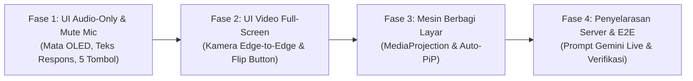

# N.E.X.A Mobile Bridge — Master Roadmap Bertahap: UI/UX Gemini Live & Screen Sharing

> **Dokumen Master:** `NEXA_GEMINI_LIVE_UI_REDESIGN_PLAN.md`  
> **Komponen:** `nexa-mobile-bridge` (Android 16, Kotlin Jetpack Compose) & `nexa-server` (Node.js 20, Live Voice Engine)  
> **Sasaran Akhir:** Antarmuka Elegan Mirip Gemini Live Android + Fitur Berbagi Layar Aman (`MediaProjection`)  
> **Prinsip Eksekusi:** **Bertahap (Phased & Testable)** — Setiap fase dapat diuji dan diverifikasi secara independen tanpa risiko merusak sistem berjalan.

---

## 1. Re-Reasoning: Mengapa Pendekatan Bertahap Sangat Penting?

Menggabungkan perombakan UI total sekaligus penambahan MediaProjection dalam satu langkah besar (*big-bang change*) memiliki risiko teknis:
1. **Pemisahan Masalah (Separation of Concerns)**: Masalah rendering Jetpack Compose (tata letak, z-index, responsivitas) terpisah secara mendasar dari masalah Android OS Service (`MediaProjection`, VirtualDisplay, ImageReader memory lifecycle).
2. **Kecepatan Uji Coba**: Dengan membaginya ke dalam 4 fase terukur, Tuan Faqih bisa langsung melihat, menguji, dan merasakan peningkatan UI di setiap tahap sebelum melangkah ke integrasi sistem berikutnya.
3. **Zero-Regression**: Memastikan fitur panggilan suara dan video yang sudah stabil saat ini tetap berjalan 100% tanpa gangguan.

---

## 2. Peta Jalan 4 Fase Eksekusi Bertahap

---

### 📌 FASE 1: Fondasi Audio Mute & Redesain UI Audio-Only (Sesuai Gambar 2)
> **Fokus:** Menghadirkan antarmuka panggilan suara murni yang elegan, bersih, dengan mata ekspresif dan kontrol dok bawah 5 tombol.

* **Pekerjaan di [`VoiceStreamHandler.kt`](file:///c:/workspace/nexa-mobile-bridge/app/src/main/java/com/nexa/mobilebridge/dispatcher/handler/VoiceStreamHandler.kt)**:
  * Menambahkan properti `@Volatile var isMicrophoneMuted: Boolean = false`.
  * Pada loop AudioRecord: lewati pengiriman audio jika `isMicrophoneMuted == true`.
* **Pekerjaan di [`FakeCallActivity.kt`](file:///c:/workspace/nexa-mobile-bridge/app/src/main/java/com/nexa/mobilebridge/ui/call/FakeCallActivity.kt)**:
  * **Header Kiri**: Status kognitif N.E.X.A (`• Mendengarkan..` / `• Mentransmisikan..`).
  * **Header Kanan**: Kapsul melayang `[ ◱ PiP Mode │ ⋮ Opsi Rute Audio ]`. Mengetuk `⋮` memunculkan `DropdownMenu` Material3 untuk rute suara (Loudspeaker, Earpiece, Bluetooth, Wired).
  * **Upper Body**: Teks putih besar respons utama N.E.X.A.
  * **Center**: `NexaExpressiveEyes` (animasi mata digital OLED N.E.X.A yang hidup).
  * **Lower Body**:
    * Tombol melayang *"Ketuk untuk menyela"* (hanya muncul saat N.E.X.A berbicara, memicu `flushOutputBuffer()`).
    * Gelembung transkrip ucapan Tuan Faqih (*`Cek, halo.`*).
  * **Dok Kontrol Bawah (5 Tombol)**:
    1. Kamera (squircle outline/mati).
    2. Bagikan Layar (squircle outline/siap).
    3. Kapsul Gelombang Suara Tengah (`LiveGeminiVoiceCapsule` beranimasi glow).
    4. Mute Mikrofon (toggle mute nyata via `isMicrophoneMuted`).
    5. Akhiri Panggilan (lingkaran merah 'X').
* **Kriteria Keberhasilan Fase 1**:
  * Panggilan suara terhubung normal dengan UI baru yang sangat bersih.
  * Tombol mute benar-benar membisukan suara Anda.
  * Tombol sela menghentikan suara N.E.X.A seketika.
  * Menu rute audio berfungsi berganti speaker/earpiece.

---

### 📌 FASE 2: Mode Video Kamera Layar Penuh (Sesuai Gambar 1)
> **Fokus:** Mengubah tampilan kamera dari kotak 3:4 kecil di tengah menjadi pratinjau imersif 100% layar HP (*edge-to-edge*).

* **Pekerjaan di [`FakeCallActivity.kt`](file:///c:/workspace/nexa-mobile-bridge/app/src/main/java/com/nexa/mobilebridge/ui/call/FakeCallActivity.kt)**:
  * Saat `isCameraActive == true`:
    * `PreviewView` CameraX diletakkan di Layer 0 latar belakang (`fillMaxSize()`, `scaleType = FILL_CENTER`).
    * Dilapisi gradien *scrim* transparan di atas dan bawah agar tombol dan teks tetap kontras.
    * Tombol **Putar Kamera** (`FlipCameraAndroid`) otomatis muncul di sebelah kiri kapsul PiP di kanan atas.
    * Tombol kamera di dok bawah menyala dengan aksen **Biru Gemini (`0xFF2563EB`)**.
    * Teks respon N.E.X.A bertransformasi menjadi kapsul subtitle melayang di atas dok bawah.
* **Kriteria Keberhasilan Fase 2**:
  * Menekan tombol kamera langsung membuka kamera layar penuh yang indah.
  * Tombol putar kamera sukses membalik lensa depan $\leftrightarrow$ belakang.
  * Menekan tombol kamera lagi mengembalikan tampilan secara mulus ke Mode Audio-Only (Mata OLED).

---

### 📌 FASE 3: Mesin Berbagi Layar (MediaProjection Engine)
> **Fokus:** Mengaktifkan kapabilitas Berbagi Layar murni (`MediaProjection`), aman untuk M-Banking, dan hemat daya.

* **Pekerjaan di [`AndroidManifest.xml`](file:///c:/workspace/nexa-mobile-bridge/app/src/main/AndroidManifest.xml)**:
  * Tambahkan `<uses-permission android:name="android.permission.FOREGROUND_SERVICE_MEDIA_PROJECTION" />`.
  * Daftarkan layanan `ScreenCaptureService` dengan `foregroundServiceType="mediaProjection"`.
* **Membangun `ScreenCaptureService.kt`** (di `com.nexa.mobilebridge.service`):
  * Menerima hasil izin tangkapan layar (`resultCode` dan `data`).
  * Menjalankan notifikasi foreground resmi *"N.E.X.A Berbagi Layar Aktif"* dengan tombol *"Berhenti"*.
  * Mengatur `VirtualDisplay` skala optimal **540 × 1200** (aspek rasio 20:9 Samsung A33).
  * Menggunakan `ImageReader(RGBA_8888, 2 buffers)` dengan throttle 1 FPS.
  * Mengompres frame layar ke JPEG (kualitas 50) $\rightarrow$ Base64 $\rightarrow$ pancarkan via `NexaBridgeService.sendEvent(json)` dengan `type: "CALL_VIDEO_FRAME"`.
* **Pekerjaan di [`FakeCallActivity.kt`](file:///c:/workspace/nexa-mobile-bridge/app/src/main/java/com/nexa/mobilebridge/ui/call/FakeCallActivity.kt)**:
  * Menghubungkan tombol "Bagikan Layar" ke launcher `mediaProjectionManager.createScreenCaptureIntent()`.
  * Begitu disetujui, layanan `ScreenCaptureService` menyala dan aplikasi **otomatis mengecil ke mode PiP**, membiarkan Tuan bebas membuka aplikasi apa pun.
  * Mutual exclusion: Mematikan kamera fisik jika berbagi layar aktif (dan sebaliknya).
* **Kriteria Keberhasilan Fase 3**:
  * Menekan Bagikan Layar memunculkan dialog izin sistem standar Android.
  * Layar dibagikan ke server, HP masuk mode PiP dengan mata N.E.X.A di pojok.
  * M-Banking (Livin'/BCA) tetap aman dengan proteksi layar hitam native `FLAG_SECURE`.

---

### 📌 FASE 4: Penyelarasan Server & Pengujian Menyeluruh (End-to-End)
> **Fokus:** Memastikan Google Gemini Live di peladen memahami konteks visual layar dan semua pengujian valid.

* **Pekerjaan di Server ([`Live_Voice_Engine.js`](file:///c:/workspace/nexa-server/src/core/Live_Voice_Engine.js))**:
  * Perbarui `NEXA_LIVE_SYSTEM_PROMPT` dengan instruksi bahwa visual dapat berupa kamera fisik atau tangkapan layar HP Tuan Faqih.
* **Verifikasi & Build**:
  * Jalankan `npm test` pada `nexa-server` (memastikan 336 tests tetap 100% pass).
  * Jalankan kompilasi Gradle pada `nexa-mobile-bridge` (`gradlew assembleDebug`).
* **Kriteria Keberhasilan Fase 4**:
  * Tuan Faqih dapat mengobrol dengan N.E.X.A sambil memperlihatkan artikel/tugas di HP, dan N.E.X.A menjawab secara kontekstual via suara.

---

## 3. Matriks Ketergantungan & File yang Disentuh

| Berkas | Lokasi | Fase | Peran Modifikasi |
|---|---|:---:|---|
| `VoiceStreamHandler.kt` | `nexa-mobile-bridge` | **Fase 1** | Implementasi flag `isMicrophoneMuted` |
| `FakeCallActivity.kt` | `nexa-mobile-bridge` | **Fase 1 & 2** | Redesain Compose UI (Audio-Only & Video Full-Screen) |
| `AndroidManifest.xml` | `nexa-mobile-bridge` | **Fase 3** | Izin `FOREGROUND_SERVICE_MEDIA_PROJECTION` & deklarasi service |
| `ScreenCaptureService.kt` | `nexa-mobile-bridge` | **Fase 3** | Mesin tangkapan layar VirtualDisplay + ImageReader 1 FPS |
| `Live_Voice_Engine.js` | `nexa-server` | **Fase 4** | Prompt awareness visual layar untuk Gemini Live |
