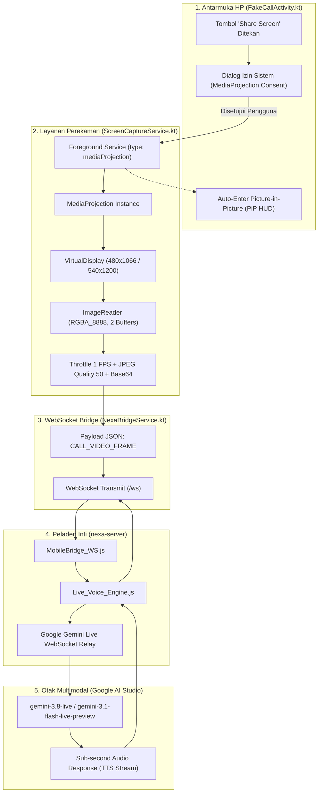

# N.E.X.A Multimodal Screen Sharing — Architectural Blueprint & Implementation Plan

> **Dokumen:** `NEXA_SCREEN_SHARING_ARCHITECTURE_PLAN.md`  
> **Komponen:** `nexa-mobile-bridge` (Android 16, Samsung A33 5G) & `nexa-server` (`Live_Voice_Engine.js`)  
> **Target Fitur:** Berbagi Layar Interaktif Real-Time (Audio-Visual Duplex) seperti Gemini Live Android  
> **Prinsip Utama:** Murni Menggunakan `MediaProjection` (Zero-Accessibility, Zero-Risk M-Banking)  

---

## 1. Executive Summary & Filosofi Desain

Fitur **Berbagi Layar (Screen Sharing)** pada N.E.X.A menghadirkan kapabilitas multimodal penuh di mana Tuan Faqih dapat membagikan tampilan layar HP-nya secara real-time ke N.E.X.A saat panggilan suara berlangsung. N.E.X.A dapat "melihat" dokumen, aplikasi, artikel, kode, grafik, atau antarmuka pengaturan yang sedang dibuka pengguna sambil terus berbincang secara duplex melalui suara.

### 🛡️ Prinsip Keamanan & Pemisahan Akses (Security Isolation):
1. **Bebas Accessibility Service (100% Aman untuk M-Banking)**:
   * Fitur ini **TIDAK MENGGUNAKAN** `AccessibilityService` sama sekali.
   * Menggunakan API resmi Android **`MediaProjectionManager`** (standar video conferencing seperti Google Meet & Gemini Live).
   * Aplikasi M-Banking (Livin' by Mandiri, BCA, BRImo) tidak akan memicu peringatan deteksi malware aksesibilitas.
2. **Proteksi Otomatis `FLAG_SECURE` Android**:
   * Seluruh aplikasi perbankan secara native diproteksi `FLAG_SECURE` oleh sistem Android.
   * Saat layar aplikasi m-banking dibuka, output frame yang ditangkap otomatis menjadi **layar hitam pekat (black screen)**, menjamin kredensial (PIN/password) tidak pernah bocor ke AI.
3. **Pengamat Pasif (Non-Intrusive)**:
   * N.E.X.A bertindak sebagai Chief of Staff yang menemani dan menganalisis secara visual via suara, tanpa mengontrol atau mengeklik layar pengguna secara otomatis.

---

## 2. Topologi Aliran Data (End-to-End Pipeline)



---

## 3. Analisis Kesiapan Komponen Saat Ini

### A. Sisi Peladen Server (`nexa-server`) — Status: **95% READY**
* **Infrastruktur Relay**: [`MobileBridge_WS.js`](file:///c:/workspace/nexa-server/src/interfaces/mobile_bridge/MobileBridge_WS.js#L187-L212) sudah menangani pesan `CALL_VIDEO_FRAME` dan langsung mengarahkan `image_chunk` ke sesi aktif.
* **Integrasi Gemini Live**: [`Live_Voice_Engine.js`](file:///c:/workspace/nexa-server/src/core/Live_Voice_Engine.js#L1077-L1105) telah membungkus frame ke dalam skema Gemini Multimodal Live API:
  ```json
  {
    "realtimeInput": {
      "video": {
        "mimeType": "image/jpeg",
        "data": "<BASE64_JPEG>"
      }
    }
  }
  ```
* **Kebutuhan Server**:
  * Memperbarui `NEXA_LIVE_SYSTEM_PROMPT` di `Live_Voice_Engine.js` agar AI sadar bahwa frame visual yang diterima bisa berupa **Berbagi Layar HP**.

---

### B. Sisi Ponsel Android (`nexa-mobile-bridge`) — Status: **Fondasi Siap, Butuh Modul Ekstensi**
* **Fondasi yang Sudah Ada**:
  * Pipa pengiriman frame video: `FakeCallActivity.sendVideoFrame(frameBase64)`.
  * Dukungan Picture-in-Picture (PiP) aktif dengan floating eyes HUD.
  * Koneksi WebSocket persistent via `NexaBridgeService.sendEvent()`.
* **Komponen Baru yang Perlu Dibuat**:
  1. `ScreenCaptureService.kt` (Foreground Service khusus `mediaProjection`).
  2. `ScreenStreamHandler.kt` (Manajer `VirtualDisplay`, `ImageReader`, throttling ~1 FPS, dan konversi bitmap ke JPEG).
  3. Modifikasi UI `FakeCallActivity.kt` (Tombol Share Screen, launcher MediaProjection, mutual exclusion dengan kamera fisik, dan integrasi PiP).
  4. Deklarasi izin di `AndroidManifest.xml` (`FOREGROUND_SERVICE_MEDIA_PROJECTION`).

---

## 4. Rincian Teknis Implementasi Android

### 4.1 Deklarasi `AndroidManifest.xml`
Pada Android 14+ (targetSdk 36), layanan perekaman layar wajib mendeklarasikan tipe `mediaProjection`:
```xml
<!-- Izin Layanan Foreground MediaProjection -->
<uses-permission android:name="android.permission.FOREGROUND_SERVICE_MEDIA_PROJECTION" />

<!-- Layanan Khusus Perekaman Layar -->
<service
    android:name=".service.ScreenCaptureService"
    android:enabled="true"
    android:exported="false"
    android:foregroundServiceType="mediaProjection">
</service>
```

### 4.2 Layanan Perekam `ScreenCaptureService.kt`
* **Tanggung Jawab**:
  1. Memulai notifikasi foreground resmi dengan channel `nexa_screen_share_channel` dan tombol aksi *"Berhenti Berbagi"*.
  2. Menginisialisasi `MediaProjection` dari `resultCode` dan `Intent data` yang dikirim dari `FakeCallActivity`.
  3. Mengatur `VirtualDisplay` dengan resolusi teroptimasi: **540 x 1200** (lebar 540 piksel menjaga aspek rasio 20:9 Samsung A33).
  4. Menggunakan `ImageReader.newInstance(width, height, PixelFormat.RGBA_8888, 2)`.
  5. Mengalirkan frame ke callback `onFrame(base64Jpeg)`.
  6. Menghindari kebocoran memori native dengan memanggil `image.close()` dan `bitmap.recycle()` seketika.

### 4.3 Throttling & Optimasi Bandwidth
* **Frame Rate**: ~1 FPS (1.000 ms antar-frame). Frekuensi ini identik dengan `CameraStreamHandler` bawaan N.E.X.A dan terbukti ideal untuk Gemini Multimodal Live API (hemat baterai, latensi rendah, data hanya ~20–30 KB/frame).
* **Kompresi JPEG**: Quality 50 (sangat tajam untuk teks dokumen/aplikasi, namun ukuran berkas sangat ringkas).

### 4.4 Integrasi UI `FakeCallActivity.kt`
* **Tombol Kontrol Baru**:
  * Menambahkan tombol *"Share Screen"* di barisan kontrol bawah (bersebelahan dengan tombol Audio Route, Kamera, dan Tutup Panggilan).
  * State reaktif: `isScreenShareActive: MutableState<Boolean>`.
  * Ikon dinamis: `Icons.Default.ScreenShare` (saat mati) $\leftrightarrow$ `Icons.Default.StopScreenShare` (saat aktif dengan aksen warna Cyan/Amber).
* **Mutual Exclusion**:
  * Jika Screen Share diaktifkan saat Kamera sedang menyala $\rightarrow$ Kamera otomatis dimatikan.
  * Jika Kamera diaktifkan saat Screen Share sedang aktif $\rightarrow$ Screen Share otomatis dimatikan.
* **Auto-PiP Workflow**:
  * Begitu Tuan Faqih menyetujui izin tangkapan layar, aktivitas otomatis memicu `enterPictureInPictureMode(buildPipParams())`.
  * Pengguna langsung berada di layar utama (Home) atau aplikasi lain, sementara N.E.X.A tetap hadir sebagai jendela kecil floating di pojok layar dengan mata digital ekspresif.

---

## 5. Rincian Teknis Implementasi Server

### Pembaruan System Prompt di `Live_Voice_Engine.js`:
Memperbarui bagian `[VISUAL MULTIMODAL]` agar model Gemini Live memahami konteks layar ponsel:
```text
[VISUAL MULTIMODAL — KAMERA & BERBAGI LAYAR]
- Jika Tuan mengaktifkan kamera HP, Anda melihat lingkungan fisik atau objek di depan kamera.
- Jika Tuan mengaktifkan BERBAGI LAYAR (Screen Sharing), Anda menerima frame tampilan layar ponsel Tuan secara langsung.
- Gunakan visual layar ini untuk: membaca teks pada artikel/dokumen/chat, menganalisis grafik, menjelaskan menu/pengaturan aplikasi, membandingkan produk, atau mendiskusikan apa pun yang sedang dibuka Tuan di layarnya.
- Tanggapi isi layar secara spontan dan alami melalui suara tanpa pernah menyebut istilah teknis seperti "saya melihat frame layar".
```

---

## 6. Rencana Tahapan Eksekusi (Step-by-Step Implementation Roadmap)

| Tahap | Modul & Berkas | Tindakan Konkret |
|:---:|---|---|
| **Tahap 1** | `nexa-mobile-bridge`<br>`AndroidManifest.xml` | Tambahkan permission `FOREGROUND_SERVICE_MEDIA_PROJECTION` dan daftarkan `ScreenCaptureService`. |
| **Tahap 2** | `nexa-mobile-bridge`<br>`service/ScreenCaptureService.kt` | Bangun foreground service `mediaProjection` dengan `VirtualDisplay`, `ImageReader`, throttling 1 FPS, dan kompresi JPEG. |
| **Tahap 3** | `nexa-mobile-bridge`<br>`ui/call/FakeCallActivity.kt` | Integrasikan launcher `MediaProjection`, tombol toggle Share Screen di Jetpack Compose UI, mutual exclusion kamera, dan transisi PiP. |
| **Tahap 4** | `nexa-server`<br>`src/core/Live_Voice_Engine.js` | Perbarui `NEXA_LIVE_SYSTEM_PROMPT` dengan kesadaran visual konteks berbagi layar (*Screen Sharing context*). |
| **Tahap 5** | Verifikasi & Pengujian | Uji build Android Gradle (`gradlew assembleDebug`), verifikasi test suite server (`npm test`), dan uji skenario M-Banking (memastikan Livin'/BCA tetap terlindungi `FLAG_SECURE`). |
