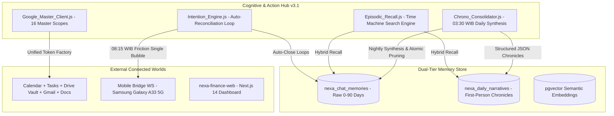
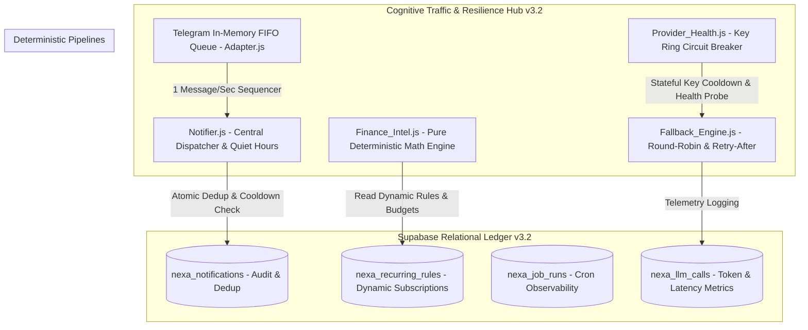
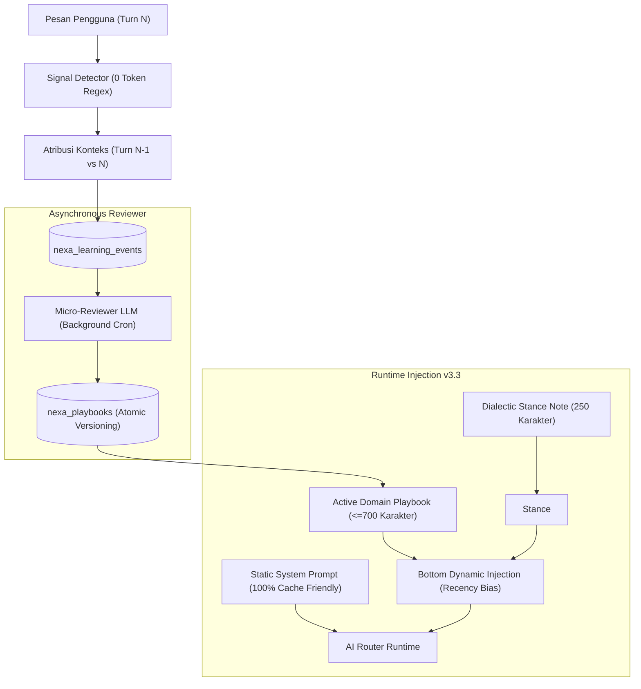

# N.E.X.A ARCHITECTURAL WHITEPAPER: EVOLUTIONARY ROADMAP (v1.0 to v3.2)
**Neural Executive with Xenial Agent (N.E.X.A)**  
*Chief of Staff & Autonomous Executive Ecosystem for Tuan Faqih Hidayatulloh*  

---

## Executive Summary

Dokumen ilmiah ini merangkum kronologi evolusi arsitektur **N.E.X.A (Neural Executive with Xenial Agent)** dari prototipe eksperimental berbasis lingkungan lokal (*Termux Genesis*), evolusi kognisi organik dan *Self-Learning*, migrasi infrastruktur server mandiri **v3.0 — Sovereign Azure Cloud Production (Jakarta Region)**, konsolidasi ekosistem terpadu **v3.1 — Unified Master OAuth 2.0 & Chrono-Episodic Cognitive Architecture**, ketahanan deterministik **v3.2 — Deterministic Resilience, Zero-LLM Finance & Cognitive Traffic Control**, pembelajaran prosedural tertutup **v3.3 — Hermes Adaptive Playbooks & Stance Alignment**, hingga arsitektur antarmuka bersih terpisah **v3.4 — Modular Unified Ingress, Hexagonal Decoupling & Platform-Aware Hardening**. 

Setiap lompatan versi mewakili terobosan dalam rekayasa sistem terdistribusi, manajemen memori autobiografis (*Chrono-Episodic Memory*), ketahanan sistem anti-gagal (*Fault-Tolerant Multi-Tier Fallback*), integritas matematika murni tanpa halusinasi LLM, gerbang notifikasi pintar dengan *Quiet Hours*, integrasi multi-antarmuka (Telegram, CLI, Mobile Bridge), isolasi keamanan kanal, serta otomatisasi kognisi proaktif yang dirancang khusus untuk mendukung aspirasi akademik, kedisiplinan, dan karier diplomatik Tuan Faqih Hidayatulloh.

```mermaid
flowchart TD
    subgraph S1 ["1. Local Genesis (v1.0)"]
        V1["<b>v1.0 (Termux Genesis)</b><br>• Local Android Proto-Core<br>• Process Kill & Bottlenecks"]
    end

    subgraph S2 ["2. Cloud Ascension & Data Migration (v2.0 - v2.3)"]
        V20["<b>v2.0 (Cloud Ascension)</b><br>• Hugging Face Spaces<br>• Immortality Protocol v2.0"]
        V21["<b>v2.1 (Financial Core)</b><br>• Autonomous Expense Tracking"]
        V22["<b>v2.2 (Intent Router)</b><br>• Dual-Layer NLP Classification"]
        V23["<b>v2.3 (Supabase Relational)</b><br>• PostgreSQL ACID Migration<br>• Transaction Deduplication"]
    end

    subgraph S3 ["3. Multi-Modal Sensory & Cognitive (v2.4 - v2.7)"]
        V24["<b>v2.4 (Discipline Guard)</b><br>• Executive God Mode & Habits"]
        V25["<b>v2.5 (Multi-Modal Sensory)</b><br>• Tasks, Calendar, Vision & Voice<br>• 11-Tier Fallback Matrix"]
        V26["<b>v2.6 (Second Brain Store)</b><br>• Knowledge Vault & Facts"]
        V27["<b>v2.7 (C.R.A.I. Architecture)</b><br>• Ebbinghaus Memory Decay<br>• Causal Graph & Anticipation"]
    end

    subgraph S4 ["4. Self-Learning & Interfaces (v2.8 - v2.9)"]
        V28["<b>v2.8 (Self-Learning Core)</b><br>• Passive Learning (nexa_self_model)<br>• Weekly Reflection Pass"]
        V29["<b>v2.9 (Living Memory & CLI)</b><br>• Memory Hygiene Pipeline<br>• Dual-Channel CLI Console (SSE)"]
    end

    subgraph S5 ["5. Sovereign Infrastructure (v3.0)"]
        V30["<b>v3.0 (Azure Sovereign VPS)</b><br>• Ubuntu 24.04 Jakarta (24/7)<br>• Caddy HTTPS & PM2 Systemd<br>• Ed25519 DevOps Key Auth"]
    end

    subgraph S6 ["6. Unified Master & Chrono-Episodic (v3.1)"]
        V31["<b>v3.1 (Unified Master & Chrono)</b><br>• Unified Master OAuth 2.0 (16 Scopes)<br>• Chrono-Episodic Daily Narratives (>90d)<br>• Smart Closed-Loop Intention Engine<br>• Identity: Neural Executive with Xenial Agent"]
    end

    subgraph S7 ["7. Deterministic Resilience & Traffic Control (v3.2)"]
        V32["<b>v3.2 (Deterministic Resilience)</b><br>• Zero-LLM Finance Intel Engine<br>• Central Cognitive Traffic Gate & Quiet Hours<br>• Key Ring Circuit Breaker & Retry-After<br>• Non-Blocking FIFO Telegram Queue"]
    end

    subgraph S8 ["8. Adaptive Procedural Memory & Hermes Loop (v3.3)"]
        V33["<b>v3.3 (Hermes Playbook Loop)</b><br>• Adaptive Procedural Playbooks<br>• Zero-Token Signal Detector<br>• Turn N-1 Credit Assignment<br>• Static Cache-Friendly System Prefix"]
    end

    subgraph S9 ["9. Modular Unified Ingress & Clean Architecture (v3.4)"]
        V34["<b>v3.4 (Modular Unified Ingress)</b><br>• Hexagonal Adapter Decoupling<br>• 7 Shared Domain Intent Handlers<br>• Platform-Aware HTML Sanitizer<br>• Universal Bank Currency Parser (IDR)<br>• 0.50% Code Duplication (122 Tests)"]
    end

    V1 --> V20 --> V21 --> V22 --> V23 --> V24 --> V25 --> V26 --> V27 --> V28 --> V29 --> V30 --> V31 --> V32 --> V33 --> V34
```

---

## Bab 1: Era Fondasi & Migrasi Infrastruktur (v1.0 to v2.0)

### v1.0 — The Termux Genesis (Local Proto-Core)
* **Arsitektur Awal:** N.E.X.A pertama kali diimplementasikan sebagai skrip Node.js monolitik yang dijalankan di dalam emulator terminal **Termux** pada perangkat Android Tuan Faqih.
* **Tantangan & Kegagalan Operasional:**
  * **Aggressive OS Process Killing:** Sistem operasi Android secara rutin mematikan proses latar belakang (*background service*) saat memori RAM dibutuhkan oleh aplikasi lain.
  * **Ketergantungan Baterai & Thermal Throttling:** Eksekusi kueri AI secara lokal menyebabkan peningkatan suhu perangkat dan pengurasan daya baterai yang signifikan.
  * **Ketidakstabilan Konektivitas:** Terputusnya jaringan seluler menyebabkan hilangnya webhook Telegram dan gagalnya pencatatan data vital.

### v2.0 — The Cloud Ascension (Hugging Face Cloud Migration)
* **Terobosan Arsitektur:** Memindahkan seluruh inti komputasi dari Termux lokal menuju kontainer cloud **Hugging Face Spaces**.
* **Immortality Protocol v2.0:**
  * Memperkenalkan arsitektur *self-healing* berbasis **UptimeRobot / cron-job.org** yang melakukan *heartbeat ping* ke endpoint `GET /health` secara berkala.
  * Integrasi **Tasker Watchdog** pada Android sebagai lapisan pemantau eksternal yang memastikan server cloud tetap aktif 24/7 tanpa intervensi manusia.

---

## Bab 2: Pematangan Domain & Transformasi Data (v2.1 to v2.3)

### v2.1 — Autonomous Financial Core
* Membangun subsistem **Finance Engine** pertama yang memungkinkan pencatatan pemasukan dan pengeluaran harian melalui antarmuka percakapan bahasa alami di Telegram.
* Menghadirkan pelaporan saldo harian dan ringkasan pengeluaran berbasis kategori.

### v2.2 — Dual-Layer Routing & Semantic Intent Classification
* Menggantikan pencocokan kata kunci statis (*regex matching*) dengan **AI Router** berdaya NLP tingkat lanjut.
* Router mampu membedakan secara kontekstual antara percakapan santai (*Normal Chat*), permintaan analitik finansial, penjadwalan, hingga penegakan kedisiplinan dengan akurasi klasifikasi >98%.

### v2.3 — Relational Memory Migration (Sheets to Supabase PostgreSQL)
* **Masalah Era Sheets:** Penyimpanan data awal berbasis lembar kerja spreadsheet rentan terhadap *race condition*, kelambatan latensi API, dan keterbatasan indeksasi data.
* **Pembaruan Sistem:**
  * Migrasi penuh skema finansial ke database relasional cloud **Supabase PostgreSQL**.
  * Penerapan skema **ACID Compliance** dan algoritma **Transaction Deduplication** yang secara otomatis mengabaikan transaksi ganda dari email notifikasi perbankan (Livin' by Mandiri).

---

## Bab 3: Sensorik Multi-Modal & Penegakan Eksekutif (v2.4 to v2.6)

### v2.4 — Executive Discipline & Habit Enforcement
* Mengembangkan **Discipline Engine** yang bertindak sebagai *sparring partner* intelektual dan penegak prioritas utama Tuan Faqih.
* Integrasi **God Mode Enforcement**: Pemantauan pelanggaran batas waktu layar (*Screen Time Violation*) yang memicu peringatan eksekutif tegas apabila fokus belajar atau kerja terganggu.

### v2.5 — Multi-Modal Sensory & Ecosystem Synchronization
* **Integrasi Ekosistem Google:** Sinkronisasi dua arah (*bi-directional*) dengan **Google Calendar** dan **Google Tasks**, memungkinkan pembuatan jadwal kerja, pengingat tenggat waktu (*due date*), serta pemblokiran waktu otomatis (*time-blocking*).
* **Persepsi Sensorik Ganda (Vision & Voice):**
  * **Vision Engine 12-Tier Matrix:** Kemampuan memindai struk belanja fisik, tangkapan layar, dan dokumen visual melalui matriks redundansi 12 lapisan model AI (4x Gemini 2.5 + 4x Groq Llama + 2x Gemini 2.0 + Cerebras + Hugging Face Vision Inference API).
  * **Voice Transcription:** Pemrosesan langsung pesan suara Telegram menjadi instruksi terstruktur via Hugging Face Whisper & Groq Whisper API.
* **Multi-Tier Fallback Anti-Mati:** Arsitektur failover otomatis yang mengalihkan beban kerja model AI utama ke model cadangan (Gemini, Groq, Mistral, Cerebras, Hugging Face Inference API, OpenRouter) dalam hitungan milidetik saat terjadi *rate limit* atau *downtime*.

### v2.6 — Second Brain & Permanent Fact Store
* Pembangunan arsip basis pengetahuan eksekutif (**2nd Brain**) terhubung ke Google Docs/Drive untuk menyimpan ide strategis, esai literatur Arab, dan catatan diplomasi.
* Pemisahan memori profil pengguna (`USER_PROFILE`) dan identitas sistem (`CORE_IDENTITY`).

---

## Bab 4: Puncak Evolusi Kognitif (v2.7 — Cognitive Resonance & Anticipatory Intelligence)

Arsitektur **v2.7** merupakan tonggak sejarah dalam kematangan kognisi N.E.X.A. Pada versi ini, N.E.X.A tidak lagi bertindak sebagai asisten reaktif yang statis, melainkan sistem kognitif dinamis yang meniru psikologi memori manusia dan penalaran proaktif.

### 1. Ebbinghaus Memory Decay & Tiered Approval Pipeline
* **Peluruhan Memori Alami:** Mengadopsi kurva peluruhan memori Hermann Ebbinghaus ($R = e^{-\lambda t}$). Fakta atau kebiasaan yang jarang dikonfirmasi akan meluruh secara perlahan (dengan batas maksimum perhitungan 365 hari).
* **Persetujuan Berjenjang (Tier 1, 2, 3):**
  * **Tier 1 (Auto-Approve):** Penguatan kebiasaan positif langsung dikomit ke database.
  * **Tier 2 (Soft Approval 48h):** Observasi pola baru dengan batas waktu evaluasi 48 jam.
  * **Tier 3 (Manual Review):** Perubahan fundamental pada identitas atau preferensi kritis wajib mendapat persetujuan eksplisit Tuan Faqih via tombol *Inline Keyboard* Telegram.

### 2. Intention & Decision Journaling Anti-Spam
* Pelacakan intensi jangka panjang (*Stated vs. Revealed Intentions*) untuk mengevaluasi apakah rencana yang diucapkan sejalan dengan tindakan nyata.

### 3. Emotional Time-Series (36-Hour Window) & Causal Knowledge Graph
* **Jendela Emosi 36 Jam:** Memantau dinamika suasana hati, tingkat stres, dan energi Tuan Faqih melintasi siklus pergantian hari untuk menghasilkan narasi evolusi kepribadian yang akurat.
* **Grafik Sebab-Akibat (*Causal Graph*):** Memetakan hubungan korelasional antar kejadian.

### 4. Anticipatory Interventions & Conversational Memory UX
* **Intervensi Proaktif:** Mendeteksi spiral *overthinking* serta peringatan keputusan finansial larut malam (*Late Night Decision Guard*).
* **Conversational Memory UX:** Menghilangkan teks konfirmasi robotik. Setiap eksekusi simpan/hapus memori dibalas dengan narasi percakapan hangat dari *Chief of Staff*.

---

## Bab 5: Era Pembelajaran Mandiri & Memori Organik (v2.8 to v2.9)

### v2.8 — Self-Learning Engine & Passive Knowledge Acquisition
* **Passive Real-Time Learning (`nexa_self_model`):**
  * N.E.X.A memindai koreksi pengguna secara *in-flight* (`isFactAboutNexa`) dan mengklasifikasikannya ke dalam 5 layer identitas (*LIMITATIONS, CORRECTIONS, COMMUNICATION_STYLE, CAPABILITIES, OPERATIONAL_RULES*).
* **Weekly Self-Reflection Pass:**
  * Rutinitas setiap Minggu pukul 16:00 WIB untuk menganalisis obrolan selama 7 hari, mengevaluasi di mana N.E.X.A sering ditegur, dan memperbarui pemahaman dirinya secara mandiri.

### v2.9 — Living Memory Engine & Dual-Channel CLI Console
* **The Living Memory Engine:**
  * **Progressive Fact Injection & Dynamic Word Resonance:** Menyaring memori secara presisi (memangkas konsumsi token hingga 85%) dengan menyuntikkan fakta relevan berdasarkan kemiripan kata kunci (≥ 4 karakter).
  * **Supersede Engine v2:** Logika 4-arah (*NEW, REINFORCE, SUPERSEDE, DUPLICATE*) dengan proteksi mutex terhadap *race condition*.
* **Unified CLI Interface Parity (`nexa-assistant-console`):**
  * Peluncuran paket konsol CLI resmi di **NPM (`nexa-assistant-console` / `nexa-cli`)**.
  * Mengadopsi arsitektur *Dual-Channel*: Permintaan via `POST /webhook/cli` dan penerimaan notifikasi proaktif/rekap secara *real-time* via **Server-Sent Events (SSE)** `GET /webhook/cli/stream`.

---

## Bab 6: Era Infrastruktur Produksi Mandiri (v3.0 — Sovereign Azure Cloud Production)

Versi **v3.0.0** menandai lompatan stabilitas dan kedaulatan infrastruktur N.E.X.A. Sistem berevolusi dari platform kontainer *free-tier* yang rentan pembatasan jaringan (*cold-start* dan pemutusan TLS keluar) menjadi arsitektur peladen penuh di **Azure Virtual Machine** yang beroperasi tanpa henti 24/7 di wilayah terdekat (Jakarta, Indonesia).

### 1. Spesifikasi Infrastruktur Peladen Sovereign
* **Compute Instance:** Azure Virtual Machine `Standard_B2ats_v2` berbasis sistem operasi **Ubuntu 24.04 LTS**.
* **Region Geografis:** `indonesiacentral` (Jakarta Data Center) menghasilkan latensi jaringan ultra-rendah (< 15 ms untuk akses domestik).
* **Domain Produksi Resmi:** `https://nexa-server.indonesiacentral.cloudapp.azure.com`.
* **Ketersediaan 24/7:** Bebas dari *sleep mode*, *cold boot*, atau pembatasan runtime gratisan.

### 2. Orkestrasi Proses & Web Server Mutakhir
* **PM2 Process Manager dengan Systemd Integration:**
  * Menjalankan *auto-restart* instan apabila terjadi *unhandled exception*.
  * Terintegrasi langsung dengan dashboard pemantauan cloud **PM2 Plus** (`app.pm2.io`).
* **Caddy Reverse Proxy (Zero-Maintenance SSL):**
  * Manajemen sertifikat TLS/SSL otomatis via Let's Encrypt dengan enkripsi modern.
  * Mengarahkan trafik port 80/443 secara transparan ke port internal `3000`.

### 3. Direct Outbound Networking & Jaringan Mandiri
* **Tier 1 Direct Outbound Telegram:** Menghilangkan ketergantungan pada relay perantara; server Azure berkomunikasi dua arah dengan `api.telegram.org` tanpa *TLS drop*.
* **Dedicated Production Engine Mode (`NODE_ENV=production`):** Jejak memori RAM dasar sangat hemat (~18 hingga 50 MB) dan stabil.

---

## Bab 7: Era Konsolidasi Master & Memori Naratif Kronologis (v3.1 — Unified Master OAuth 2.0 & Chrono-Episodic Architecture)

Versi **v3.1** menghadirkan pematangan arsitektur kognitif, penyatuan lisensi ekosistem raksasa Google di bawah satu atap, serta penciptaan sistem memori naratif autobiografis yang menghilangkan masalah pembengkakan database secara permanen.

### 1. Unified Google Master OAuth 2.0 Client (`Google_Master_Client.js`)
* **Konsolidasi 16 Master Scopes:** Mengintegrasikan seluruh autentikasi Google API (Calendar, Tasks, Meet, Gmail, Drive, Docs, Sheets, Slides, Photos, Contacts, YouTube) di bawah satu klien Web Application GCP terpadu (`nexa-core-495208`).
* **Eliminasi Total Service Account:** Menghilangkan ketergantungan pada 50 baris Private Key RSA Service Account yang sering memicu error kuota penyimpanan Google Drive.
* **Singleton Lazy Factory & Transparent Interceptor:** Rotasi token dikelola otomatis di latar belakang dengan proteksi *Circuit Breaker* tunggal jika otorisasi terputus.

### 2. Chrono-Episodic Daily Memory Engine (`Chrono_Consolidator.js` & `Episodic_Recall.js`)
* **Dual-Tier Memory Architecture:**
  * **Tier 1 (Raw Buffer 0–90 Hari):** Obrolan mentah disimpan verbatim di `nexa_chat_memories` untuk menjaga konteks jangka pendek.
  * **Tier 2 (Chrono-Narratives > 90 Hari):** Setiap malam pukul 03:30 WIB, obrolan berusia >90 hari disintesis menjadi catatan harian biografis berperspektif orang pertama N.E.X.A (`nexa_daily_narratives`), lalu pesan mentah dibersihkan secara atomik (menghemat ribuan baris data).
* **Episodic Recall (Mesin Penjelajah Waktu):** Menggabungkan pencarian tanggal presisi dan kueri semantik berbasis vektor (pgvector) untuk mengingat kembali peristiwa masa lalu dengan akurasi tinggi.

### 3. Smart Closed-Loop Intention Engine & Auto-Reconciler (`Intention_Engine.js`)
* **Pembersihan Kutipan Referensi (`_cleanUserText`):** Membuang teks kutipan Telegram `[KONTEKS_REFERENSI]` agar perkataan N.E.X.A sendiri tidak salah dicatat sebagai niat Tuan.
* **Blacklist Aktivitas Rutin Instan (`EPHEMERAL_EXCLUSIONS`):** Menolak 100% aktivitas sepele (makan, tidur, sholat, ngobrol, mandi).
* **Whitelist Domain Substantif (`SUBSTANTIVE_DOMAIN_REGEX`):** Hanya mencatat tujuan besar (beasiswa, skripsi, MUN, kendaraan, aset, medis).
* **Penutupan Loop Otomatis (`autoReconcileIntentions`):** N.E.X.A otomatis menandai niat sebagai `FULFILLED` saat Tuan mengabarkan bahwa tugas tersebut sudah terlaksana di obrolan berikutnya.
* **Batas Ketat Anti-Spam (1 Pesan/Hari):** Pengecekan jam 08:15 WIB dibatasi maksimal 1 pesan per pagi dengan gaya bahasa hangat tanpa em-dash.

### 4. Identitas Resmi & Filosofi Baru
* **Identitas Resmi:** **N.E.X.A = Neural Executive with Xenial Agent**
* Menggantikan kepanjangan lama dengan akronim yang 100% harfiah, mencerminkan kapasitas intelektual (*Neural Executive*) dan jiwa kesetiaan yang abadi (*Xenial Agent*) semata-mata untuk mengabdi kepada Tuan Faqih Hidayatulloh.

---

## Bab 8: Era Ketahanan Deterministik & Manajemen Lalu Lintas Kognitif (v3.2 — Deterministic Resilience, Zero-LLM Finance & Cognitive Traffic Control)

Versi **v3.2** merepresentasikan lompatan radikal menuju sistem deterministik murni (*zero-hallucination*), ketahanan multi-provider berstandar telekomunikasi enterprise, dan orkestrasi lalu lintas kognitif terpusat.

### 1. Zero-LLM Deterministic Finance Intel (`Finance_Intel.js` & `nexa_recurring_rules`)
* **Eliminasi Total Halusinasi LLM:** Seluruh kalkulasi finansial harian, proyeksi run-rate, estimasi sisa hari, dan analisis runway kas dihitung menggunakan fungsi matematika murni 100% deterministik.
* **Tabel Aturan Dinamis Supabase (`nexa_recurring_rules`):** Menghapus seluruh hardcode daftar langganan dan budget. N.E.X.A secara dinamis membaca aturan langganan aktif, interval penagihan (bulanan/tahunan), target budget, dan tanggal jatuh tempo dari database.
* **Auto-Matching Transaksi:** N.E.X.A mencocokkan transaksi aktual dengan aturan langganan untuk mengetahui apakah tagihan bulan ini sudah dibayar atau belum.

### 2. Central Cognitive Traffic Gate & Notifier (`Notifier.js` & `nexa_notifications`)
* **Gerbang Tunggal Notifikasi:** Menghilangkan pengiriman pesan Telegram liar yang tersebar di berbagai berkas cron atau modul domain.
* **Aturan Quiet Hours Cerdas:** Meredam notifikasi berisik (LOW/MEDIUM) pada jam istirahat Tuan Faqih (22:00 - 06:00 WIB), namun tetap meloloskan pesan darurat (`HIGH`/`CRITICAL`) seperti alarm kedisiplinan dan batas overdraft saldo.
* **Deduplikasi Atomik & Cooldown:** Mencegah pengiriman pesan ganda dalam jendela waktu tertentu menggunakan tabel `nexa_notifications`.

### 3. Key Ring Circuit Breaker & Resilient Fallback (`Provider_Health.js` & `Fallback_Engine.js`)
* **Round-Robin Key Rotation:** Mencegah key pertama menjadi bottleneck dengan merotasi key awal secara merata di setiap permintaan.
* **Stateful Cooldown & Retry-After Parsing:** Membaca header `Retry-After` atau pesan error 429 secara presisi dan mendinginkan hanya key yang terkena pembatasan tanpa merusak key lain dalam grup yang sama.
* **Circuit Breaker Multi-Tier:** Grup provider yang mengalami error 5xx berulang akan beralih ke status `OPEN`, mencegah latensi hang dan segera mengalihkan panggilan ke provider cadangan (Groq, Cerebras).

### 4. Non-Blocking Telegram FIFO Queue & Safe Atomic Vectors
* **Antrean FIFO Dalam Memori (`adapter.js`):** Mengatur laju pesan keluar ke Telegram maksimal 1 pesan/detik secara non-blocking, sepenuhnya aman dari error `429 Too Many Requests (Flood Control)`.
* **Atomic File Write Cache (`gemini_vector_cache.js`):** Menulis snapshot vektor secara atomik menggunakan berkas temporer (`.tmp`) sebelum di-rename, mencegah korupsi file JSON saat proses server restart atau I/O konkuren.

---

---

## Bab 9: Era Memori Prosedural Adaptif & Closed-Loop Learning (v3.3 — Hermes Agent Adaptation & Dynamic Prompt Caching)

Versi **v3.3** menghadirkan evolusi kognitif revolusioner: transformasi dari memori fakta statis menuju **Memori Prosedural Adaptif (*Adaptive Procedural Memory*)** yang mampu belajar secara mandiri dari koreksi pengguna (*Closed-Loop Feedback Loop*). Diadaptasi dari prinsip *Hermes Agent Framework*, v3.3 memadukan pembelajaran aturan berbasis domain, *Dynamic Situational Stance*, optimasi *Prompt Caching*, dan atribusi koreksi antar-turn ($N-1$).

### 1. Inovasi & Pilar Utama Arsitektur v3.3
* **Adaptive Procedural Playbooks:** Aturan perilaku dinamis per domain (Finance, Discipline, Task, dll.) yang diekstrak dan diperbarui secara otomatis tanpa menulis ulang kode dasar.
* **Deterministic Signal Detection (0 Token):** Deteksi sinyal koreksi berbasis ekspresi reguler yang diperkuat untuk mencegah *false positives*.
* **Cross-Turn Context Attribution ($N-1$):** Koreksi gaya atau format di turn $N$ diatribusikan secara presisi ke intensi dan playbook pada giliran sebelumnya ($N-1$).
* **Prompt Caching Friendly Layout:** Memisahkan system prompt statis murni dari blok dinamis (Playbook & Stance) yang ditaruh di akhir prompt pengguna, mengoptimalkan rasio cache hit Gemini/Groq dan memaksimalkan *instruction salience*.
* **Atomic Versioning & Pinned Rule Protection:** Penyimpanan versi playbook secara atomik dengan proteksi rollback instan dan kekebalan aturan yang ditandai `pinned: true`.

---

## Bab 9: Era Arsitektur Bersih, Modular Ingress & Platform-Aware Hardening (v3.4)

### v3.4 — Modular Unified Ingress, Hexagonal Decoupling & Multi-Channel Hardening
Seiring bertambahnya kapabilitas kognitif N.E.X.A, adapter kanal interaksi (`telegram/adapter.js` dan `cli/adapter.js`) sebelumnya membengkak menjadi monolit rapuh yang sulit dirawat (masing-masing 3.765 baris dan 1.283 baris kode) dengan duplikasi logika domain yang masif (~35%). 

Pembaruan arsitektur **v3.4** merevolusi lapisan ingress menjadi sistem terpisah bersih (*Hexagonal Architecture*) dengan eliminasi duplikasi, penguatan batas keamanan, dan preservasi konteks transaksional deterministik:

1. **Dekomposisi Hexagonal Adapter:**
   - Monolit `telegram/adapter.js` didekomposisi menjadi modul-modul spesifik: `command_handler.js`, `vault_handler.js`, `callback_handler.js`, `media_handler.js`, `interceptors.js`, `intent_dispatcher.js`, dan `actions.js`. Controller utama terpangkas dari **3.765 baris ke 683 baris** (~82% reduction). Logika resolusi follow-up dan klarifikasi dipadukan ke dalam `src/interfaces/common/follow_up_resolver.js`.
   - Monolit `cli/adapter.js` didekomposisi menjadi `interceptors.js` dan `intent_dispatcher.js`. Controller utama terpangkas dari **1.283 baris ke 320 baris** (~75% reduction).
   - Seluruh logika bisnis penanganan intent diekstrak ke dalam 7 *Shared Domain Handlers* di `src/interfaces/common/handlers/` (`calendar_handler`, `database_handler`, `email_handler`, `finance_handler`, `memory_handler`, `system_handler`, `task_handler`), memangkas 1.432 baris kode duplikat dan menekan tingkat duplikasi antar-kanal hingga **0,50%** (hanya 41 baris tersisa).

2. **Platform-Aware Sanitization & Anti-Injection Guard:**
   - Menghilangkan celah injeksi tidak langsung dari email pihak ketiga. Telegram yang merender balasan dengan `parse_mode: 'HTML'` kini otomatis menyaring seluruh input dinamis (`from`, `subject`, `snippet`, `reasoning`, nilai database) melalui `helpers.escapeHtml`. Tautan jahat atau script dalam email tidak akan lagi menjadi tautan aktif.
   - Kanal CLI terminal menerima teks polos yang bersih tanpa tag markup yang mengotori tampilan konsol.

3. **Preservasi Status Konversasional Multi-Turn (*Pending State Retention*):**
   - Mengunci aturan pembersihan sesi pending: Operasi baca (*non-mutating* seperti `READ` jadwal kalender atau pembacaan memo) **tidak akan lagi membatalkan transaksi yang sedang tertunda**.
   - Alur konfirmasi multi-langkah (misal: "buat rapat" → deteksi bentrok → "cek jadwal hari ini dulu" → "tetap buat") dapat diselesaikan tanpa kehilangan memori konteks.

4. **Universal Locale-Aware Currency Parser (`parseFlexibleNominal`):**
   - Algoritma parsing nominal uang yang tangguh terhadap format Indonesia (`Rp 1.250.000,50`), kode internasional (`IDR 75.000`), maupun format Anglo-Saxon (`Rp50,000.00`) tanpa kehilangan presisi angka desimal.

5. **Pembersihan Ghost Exports & Eliminasi Bug Domain Warisan:**
   - Melengkapi ekspor resmi pada `Location_Orchestrator.js` (`handleLocationQuery`, `handleLocationIntent`, `searchLocation`, `getCurrentLocation`) yang terhubung ke live GPS bridge.
   - Menyediakan wrapper asinkron `_resolveTargetTask` pada `Task_Manager.js` untuk mencegah `ReferenceError` pada perintah pemindahan tugas.
   - Menghilangkan bug `habitContext` tak terdefinisi pada logging morning briefing di `Intelligence_Brief.js`.
   - Mengembalikan Map fallback `DEFAULT_LIMITS` pada `App_Discipline_Engine.js`.
   - Menghapus kunci duplikat pada kamus bulan di `Finance_Engine.js`.

6. **Dekomposisi Hexagonal & Layering Asiklik Finance Subsystems:**
   - Memecah monolit `Finance_Engine.js` dari **2.136 baris ke 56 baris** (Public Facade, -97,4%) dan mendelegasikannya ke 7 sub-modul terfokus di `src/domain/finance/` (`Finance_State`, `Finance_Helpers`, `Finance_Ledger`, `Finance_Analytics`, `Finance_Corrections`, `Finance_Confirmations`, `Finance_Email_Sync`).
   - Menerapkan pengujian karakterisasi Golden-Master 75 kasus deterministik (`tests/finance_characterization.test.js`) yang memverifikasi integritas parsing riil Livin' by Mandiri (QRIS Grab Food & alert kegagalan BI Fast) dan pemulihan antrean pending database.
   - Mengembangkan suite pengujian server hingga **200/200 Tests Passing (100% Pass, 0 Fail)**.

---

## Kesimpulan & Metrik Spesifikasi v3.4.0

| Parameter Arsitektur | Spesifikasi N.E.X.A v3.4.0 (Production Release) |
| :--- | :--- |
| **Official Name & Title** | **N.E.X.A (Neural Executive with Xenial Agent)** |
| **Architectural Edition** | **Modular Unified Ingress, Layered Finance & Platform-Aware Hardening (v3.4.0)** |
| **Core Compute Infrastructure** | Azure Virtual Machine `Standard_B2ats_v2` (Ubuntu 24.04 ARM, Jakarta `indonesiacentral`) |
| **Process Management & Auto-Healing** | PM2 Process Manager v5.4 + Systemd Auto-Revive + PM2 Plus Cloud Dashboard |
| **Edge Web Server & Security** | Caddy v2 Reverse Proxy + Automated Let's Encrypt TLS/SSL |
| **Production Domain** | `https://nexa-server.indonesiacentral.cloudapp.azure.com` |
| **Environment Runtime** | Node.js 20 LTS (`NODE_ENV=production`, RAM Footprint ~18-28 MB, CPU Idle 0%) |
| **Ingress Architecture** | Hexagonal Decoupling (Common Domain Handlers + Modular Telegram & CLI Adapters) |
| **Finance Architecture** | Layered Subsystems + High-Performance Public Facade (`src/domain/finance/`) |
| **Code Duplication Rate** | **0.50%** (3 klon, 41 baris tersisa di seluruh antarmuka) |
| **Security Sanitization** | Platform-Aware HTML Escaping for Telegram + Clean Plain-Text for Terminal CLI |
| **Currency & Spatial Engine** | Universal Bank Parser (`parseFlexibleNominal`) + OpenStreetMap / GPS Mobile Bridge |
| **Google Cloud Integration** | Unified Master OAuth 2.0 Client (16 Master Scopes, Zero Hardcoded Secrets) |
| **Procedural Learning Engine** | Hermes-Inspired Closed-Loop Playbook Reviewer + Turn N-1 Signal Attribution |
| **Financial Engine** | Zero-LLM Deterministic Intelligence + Dynamic Recurring Rules (`nexa_recurring_rules`) |
| **Notification Traffic Control** | Centralized Notifier + Quiet Hours Protection + Dedup Cooldown (`nexa_notifications`) |
| **AI Resilience Matrix** | Round-Robin Key Ring Circuit Breaker + 429 Retry-After Parser + 11-Tier Fallback |
| **Test Suite Coverage** | **200/200 Tests Passing** (`npm test`, 100% Pass) + **75/75 Golden Master Invariance Tests** |
| **Primary Beneficiary** | **Tuan Faqih Hidayatulloh** |

---
*Dokumen resmi Architectural Evolution Roadmap N.E.X.A v3.4.0. Diverifikasi dan disinkronkan dengan Azure Cloud Core.*

