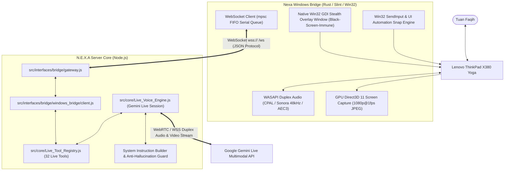

# 🖥️ N.E.X.A Windows Bridge & Live Voice Integration Specification

**Document ID:** `NEXA-WIN-INTEG-001`  
**Version:** 1.0 (Production Edition)  
**Target Hardware:** Lenovo ThinkPad X380 Yoga — Windows 11 Pro  
**Transport:** WebSocket (`/ws` atau `/ws/windows`) dengan TLS Enforced pada Remote  
**Core Modules:** [`src/core/Live_Voice_Engine.js`](../src/core/Live_Voice_Engine.js), [`src/core/Live_Tool_Registry.js`](../src/core/Live_Tool_Registry.js), [`src/interfaces/bridge/windows_bridge/`](../src/interfaces/bridge/windows_bridge/)  
**Client Repository:** [`nexa-windows-bridge`](https://github.com/Knightrelaxed/nexa-windows-bridge)  

---

## 📌 1. Executive Summary & Arsitektur Sistem

Dokumen ini merupakan **spesifikasi referensi teknis komprehensif** yang mendokumentasikan integrasi antara **N.E.X.A Server** (Cloud Cognitive Core) dan **Nexa Windows Bridge** (Native Rust Desktop Companion). Integrasi ini menghadirkan pengalaman asisten AI multimodal suara & penglihatan real-time (Gemini Live Multimodal Streaming) yang memiliki otoritas penuh untuk mengotomasi desktop Windows secara otonom dan aman.



---

## 🏛️ 2. Protokol Komunikasi & Mekanisme Transport

### 2.1. Handshake & Autentikasi
Klien desktop Rust terhubung ke endpoint WebSocket server dengan menyertakan header:
```http
GET /ws HTTP/1.1
Host: nexa.domain.com
Upgrade: websocket
Connection: Upgrade
Authorization: Bearer <auth_token>
X-Device-Type: windows
```
- **Strict TLS Enforced:** Koneksi non-localhost mewajibkan protokol TLS (`wss://`).
- **Heartbeat & Keepalive Watchdog:** Klien mengirimkan `{"type": "PING"}` setiap 5 detik. Server membalas `{"type": "PONG"}`. Jika dalam 15 detik tidak ada aktivitas jaringan, klien otomatis memutus soket dan melakukan reconnect dengan exponential backoff (500ms hingga 10.000ms).

---

## 🛠️ 3. Katalog Lengkap Tool Otomasi Desktop (`Live_Tool_Registry.js`)

Seluruh perintah otomatisasi dieksekusi melalui fungsi `executeLiveTool` yang mendelegasikan instruksi ke klien bridge melalui amplop `EXECUTE_COMMAND`:

### 3.1. `desktopClick` (Klik Mouse Presisi & Terproteksi)
* **Deskripsi:** Melakukan klik mouse fisik pada koordinat ternormalisasi `(x, y)` skala 0–1000.
* **Parameter:**
  - `x`: Angka horizontal `0.0..=1000.0`.
  - `y`: Angka vertikal `0.0..=1000.0`.
  - `button`: `"LEFT"`, `"RIGHT"`, atau `"MIDDLE"` (default: `"LEFT"`).
  - `double_click`: `true` / `false` (default: `false`).
* **Proteksi HUD Nexa Bridge (`is_point_inside_own_interactive_window`):**
  Jika AI salah mengira bahwa koordinat HUD kapsul mengambang (*floating pill*) Nexa Bridge adalah tombol aplikasi latar belakang, aksi otomatis ditolak secara aman (`GUARD_OWN_PROCESS`) dengan pesan error yang mengarahkan model untuk memanggil `closeWindow()`.

### 3.2. `desktopScroll` (Pengguliran Layar Pintar dengan Target Koordinat)
* **Deskripsi:** Menggulir halaman dokumen, web, atau jendela aktif ke atas atau ke bawah.
* **Parameter:**
  - `direction`: `"DOWN"` (gulir ke bawah) atau `"UP"` (gulir ke atas).
  - `amount`: Jumlah notch roda mouse (default: 3).
  - `x`: Koordinat horizontal opsional (0–1000) untuk target panel yang ingin digulir.
  - `y`: Koordinat vertikal opsional (0–1000) untuk target panel yang ingin digulir.
* **Fitur Deadzone Auto-Centering Recovery:**
  Jika parameter `x` dan `y` tidak disertakan dan kursor mouse saat ini tertinggal di area header browser / tab bar (`y < 220px`) atau taskbar (`y > screen_h - 60px`), fungsi `desktop_scroll` di bridge secara otomatis mendeteksi deadzone via `GetCursorPos` dan memindahkan kursor ke tengah konten (`norm_x: 500, norm_y: 500`) sebelum memutar roda mouse `MOUSEEVENTF_WHEEL`. Hal ini menjamin konten halaman selalu tergulir mulus tanpa tertahan di header.

### 3.3. `desktopTypeText` (Pengetikan Teks Unicode Bebas Layout)
* **Deskripsi:** Mengetikkan teks secara otomatis ke input form atau dokumen aktif.
* **Parameter:**
  - `text`: String teks yang akan diketikkan.
  - `press_enter`: `true` / `false` untuk menekan tombol Enter di akhir teks.
* **Proteksi Terminal Konsol:** Jika jendela aktif di latar depan adalah terminal (`cmd.exe`, `powershell.exe`, `regedit.exe`, dll.), pengetikan otomatis diblokir demi keamanan sistem.

### 3.4. `desktopPressKey` (Penekanan Tombol Virtual & Shortcut)
* **Deskripsi:** Menekan tombol fungsional keyboard atau kombinasi tombol khusus.
* **Parameter:**
  - `key`: `"ENTER"`, `"SPACE"`, `"ESCAPE"`, `"TAB"`, `"BACKSPACE"`, `"CTRL+C"`, `"CTRL+V"`, `"ALT+TAB"`, dll.

### 3.5. `highlightElement` (Sorotan Bounding Box Visual)
* **Deskripsi:** Menyorot elemen visual di layar monitor untuk memandu pandangan pengguna.
* **Parameter:**
  - `ymin`, `xmin`, `ymax`, `xmax`: Koordinat bounding box (skala 0–1000).
  - `style`: `"BOX"`, `"RING"`, `"POINTER"`, `"SPOTLIGHT"` (default: `"BOX"`).
  - `label`: Label teks mengambang opsional.
* **Kekebalan Layar Hitam (Black Screen Immunity):**
  Menggunakan jendela native Win32 GDI Stealth Overlay Window (`WS_EX_LAYERED | WS_EX_TRANSPARENT | LWA_COLORKEY 0x00000000`) murni tanpa swapchain grafis OpenGL/Slint, menjamin transparansi 100% dan bebas dari kedipan layar hitam DWM.

### 3.6. `pointCursor` & `clearHighlights`
* **`pointCursor(x, y)`:** Menampilkan laser reticle penunjuk kursor di koordinat target.
* **`clearHighlights()`:** Menghapus seluruh sorotan aktif seketika.

### 3.7. `closeWindow` (Penutupan Jendela Aplikasi Anggun)
* **Deskripsi:** Menutup jendela aplikasi yang sedang aktif menggunakan pesan Win32 `WM_CLOSE`.
* **Keamanan & Resolusi Z-Order Otomatis:**
  - Mencegah penutupan proses kritis Windows (`csrss.exe`, `dwm.exe`, `explorer.exe`).
  - Jika jendela foreground saat pemanggilan kebetulan adalah Nexa Bridge sendiri (misalnya karena terklik atau kombinasi ALT+TAB), sistem secara cerdas mengenumerasi Z-order jendela top-level dan menutup jendela aplikasi pengguna teratas di bawahnya tanpa melempar error penutupan diri sendiri.

### 3.8. `getOpenWindows` (Pendataan Jendela Aktif)
* **Deskripsi:** Mengambil daftar seluruh jendela aplikasi pengguna yang sedang terbuka di layar desktop.
* Mengembalikan array objek berisi `title`, `process_name`, `pid`, dan status `is_foreground`.

### 3.9. `taskView` (Windows Task View)
* **Deskripsi:** Membuka tampilan Task View Windows (`Win + Tab`) secara persisten tanpa menghilang dalam sekejap.

### 3.10. `controlDeviceHardware` (Kendali Perangkat Keras)
* **Aksi yang Didukung:**
  - `LAUNCH_APP`: Membuka aplikasi whitelist (Chrome, Notepad, VS Code, Calculator, Explorer, Terminal) atau tautan URL resmi yang telah divalidasi.
  - `SET_VOLUME`: Menyesuaikan volume speaker laptop (0–100).
  - `MUTE` / `UNMUTE`: Membisukan atau memulihkan audio laptop.
  - `LOCK_SCREEN`: Mengunci workstation Windows (`LockWorkStation`).
  - `TAKE_SCREENSHOT`: Menangkap gambar layar desktop.
  - `GET_BATTERY_STATUS`: Membaca telemetri baterai real-time (persentase, status charging AC/DC).
  - `GET_SYSTEM_METRICS`: Membaca utilisasi CPU, RAM, dan resolusi monitor.

---

## 🧠 4. Kebijakan Integritas Kognitif & Prompt Directives (`Live_Voice_Engine.js`)

Agar interaksi suara asisten AI tidak berhalusinasi atau memberikan klaim palsu, instruksi sistem (*System Instruction*) Gemini Live dilengkapi dengan 6 aturan mutlak berikut:

### 1. Integritas Aksi & Anti-Klaim Palsu (Zero False Action Claims)
* **DILARANG KERAS** mengatakan *"sudah saya buka"*, *"sudah saya klik"*, *"sudah saya tutup"*, *"sudah saya gulir"*, atau *"sudah saya ubah"* **TANPA BENAR-BENAR MEMANGGIL TOOL** pada giliran bicara yang sama!
* Setiap kali Tuan meminta aksi di komputer (buka tab catatan, cek saldo token, klik tombol, gulir layar, tutup jendela), AI **WAJIB MEMANGGIL TOOL** yang bersangkutan.
* Saat tool baru dipanggil, AI wajib menyampaikan aksi dalam bentuk tindakan yang sedang berjalan (contoh: *"Baik Tuan, saya buka sekarang..."*, *"Saya bantu klik tombolnya..."*, *"Saya gulirkan ke bawah..."*).

### 2. Verifikasi Visual Mandiri (Vision-Based Self-Correction)
* AI menerima aliran video cuplikan layar D3D11 secara terus-menerus. AI **WAJIB MEMERIKSA PERUBAHAN TAMPILAN LAYAR** setelah tool dieksekusi.
* **DILARANG BERBOHONG** menyatakan bahwa aksi berhasil jika tangkapan layar berikutnya masih menampilkan kondisi yang sama persis seperti sebelumnya.
* Jika tombol belum tertekan atau layar belum merespons, AI harus mengakui secara jujur dan tanggap: *"Sepertinya tadi belum merespons di layar, saya ulangi klik lagi ya Tuan."*

### 3. Mandat Mutlak Penutupan Jendela via `closeWindow()`
* Saat Tuan berkata *"close"*, *"tutup aplikasi"*, *"tutup jendela"*, *"tutup tab"*, atau *"klik silang di pojok kanan untuk menutup"*:
  **SELALU DAN WAJIB PANGGIL `closeWindow()`**.
* **DILARANG KERAS** mencoba mengira-ngira koordinat tombol silang (X) di pojok jendela menggunakan `desktopClick`. Koordinat tombol silang sangat mudah meleset mengenai tab lain, tombol minimize, atau HUD Nexa Bridge.
* **DILARANG** menekan shortcut `ALT+TAB` lalu `ALT+F4` karena berisiko memindahkan fokus secara keliru ke jendela Nexa Bridge.

### 4. Pengguliran Layar Berkoordinat (`desktopScroll`)
* Gunakan `desktopScroll(direction: "DOWN"|"UP", amount: 3, x?: number, y?: number)`.
* Jika ingin menggulir area spesifik (seperti daftar catatan, panel samping, atau dokumen), berikan parameter `x` dan `y` di dalam area konten (jauhkan dari header/tab/toolbar atas di `y < 220px`).
* Jika tidak menyertakan koordinat, sistem Windows Bridge secara otomatis memindahkan kursor ke tengah layar sebelum memutar roda mouse.

### 5. Integritas Penelusuran Web & Anti-Iklan Bersponsor
* **DILARANG KERAS** mengeklik tautan iklan bersponsor (*"Ad"*, *"Bersponsor"*, *"Sponsored"*, *"Promoted"*, atau marketplace perantara) saat Tuan meminta membuka situs resmi suatu produk atau brand.
* Gulir ke bawah (`desktopScroll`) hingga menemukan URL domain resmi yang asli (contoh: `lenovo.com`), lalu klik tautan domain resmi tersebut.

### 6. Ketelitian Memilih Elemen Sepele (Tab, Tombol, Angka, Profil)
* BACA teks pada layar dengan teliti sebelum mengeklik.
* Arahkan koordinat klik `(x, y)` tepat ke pusat kotak teks elemen yang dimaksud, bukan di tepian atau area kosong di sekitarnya.
* DILARANG mengeklik antarmuka floating capsule/pill HUD Nexa Bridge di bagian atas tengah layar.

---

## 📊 5. Tabel Verifikasi & Status Pengujian

| Pengujian / Audit | Modul Terkait | Hasil |
| :--- | :--- | :---: |
| **Kekebalan Layar Hitam (Black Screen Immunity)** | `src/automation/highlighter.rs` (Native Win32 GDI Stealth Overlay) | **LULUS ✅** |
| **Deadzone Auto-Centering Recovery pada Scroll** | `src/automation/input.rs:desktop_scroll` | **LULUS ✅** |
| **Proteksi Klik Terhadap HUD Kapsul Sendiri** | `src/automation/uia/guard.rs:is_point_inside_own_interactive_window` | **LULUS ✅** |
| **Graceful Close dengan Fallback Z-Order** | `src/automation/input.rs:close_active_window` | **LULUS ✅** |
| **Dukungan Koordinat Target pada `desktopScroll`** | `src/core/Live_Tool_Registry.js` & `tests/audit_bugs.test.js` | **LULUS ✅** |
| **Aturan Integritas Aksi & Anti-Klaim Palsu** | `src/core/Live_Voice_Engine.js` | **LULUS ✅** |
| **Pengujian Unit Rust (`nexa-windows-bridge`)** | 118 Unit Tests (`cargo test --bin nexa-bridge`) | **118 PASS ✅** |
| **Pengujian Unit Node.js (`nexa-server`)** | 439 Unit Tests (`npm test`) | **439 PASS ✅** |
