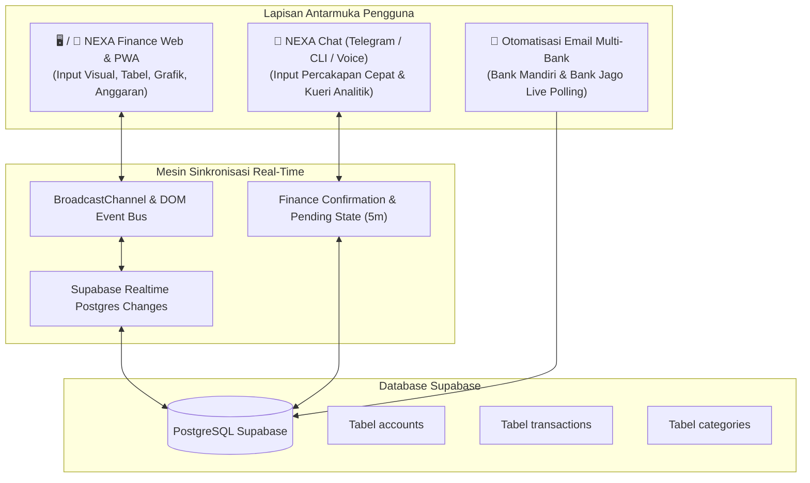

# 📘 Buku Panduan Pengguna & Pengalaman Pengguna (UX Guide)
## Ekosistem NEXA Finance — Web, PWA, & Percakapan AI

---

## 🌟 1. Filosofi & Arsitektur Ekosistem NEXA Finance

Ekosistem **NEXA Finance** dibangun dengan prinsip **Dual-Interface, Single-Truth**:
Satu database PostgreSQL di Supabase yang menjadi sumber kebenaran tunggal (*Single Source of Truth*), dapat diakses melalui dua pengalaman pengguna yang saling melengkapi:



1. **Pengalaman Visual (Web & PWA):** Terbaik untuk evaluasi mingguan/bulanan, melihat grafik tren, merencanakan anggaran, dan audit menyeluruh.
2. **Pengalaman Percakapan (NEXA Chat / Telegram):** Terbaik untuk pencatatan kilat langsung setelah bertransaksi di kasir, koreksi suara santai, dan kueri analitik cepat tanpa membuka aplikasi.
3. **Otomatisasi Latar Belakang (Email Multi-Bank Sync):** Transaksi dari email perbankan (Mandiri Livin & Bank Jago) disinkronkan otomatis tanpa perlu dicatat manual.

---

## 🖥️ 2. Pengalaman Pengguna: NEXA Finance Web & PWA (Manual)

### 2.1 Dasbor Eksekutif & Mode Privasi
* **Kartu Master "Total Saldo" (Paling Kiri):**
  * Menampilkan akumulasi kekayaan bersih dari seluruh rekening aktif.
  * Bersifat *client-side aggregate*, tidak mengotori database `accounts`.
  * **Fitur Mode Privasi (Ikon Mata 👁️):** Klik ikon mata untuk menyamarkan seluruh nominal (Total Saldo dan saldo per rekening) menjadi `Rp ••••••••` saat berada di tempat umum. Preferensi ini otomatis tersimpan di perangkat.
* **Deretan Kartu Rekening (Horizontal Scroll):**
  * Kartu individual bank (misal: Bank Mandiri gradien biru, Bank Jago gradien hijau zamrud).
  * Menampilkan saldo riil per rekening yang dihitung dari saldo awal + seluruh mutasi masuk/keluar.
  * Tombol **`+ Tambah Akun`** untuk membuat rekening bank atau dompet baru.
* **Spedometer Finansial:**
  * Tiga spedometer indikator cepat: **Saldo Saat Ini**, **Arus Kas Bersih**, dan **Total Pengeluaran**.
* **Widget Fleksibel (Drag & Drop):**
  * Kartu widget seperti *Tren Saldo*, *Struktur Pengeluaran (Donut Chart)*, dan *Perbandingan Periode* dapat ditata ulang posisinya dengan tombol **"Letak Terbuka / Letak Dikunci"**.

---

### 2.2 Alur Pencatatan Transaksi (Modal Input)

Akses modal melalui tombol hijau **`+ Catatan Baru`** di navigasi atas atau tombol `+` di mobile.

#### A. Transaksi Pengeluaran (*Expense*)
1. Pilih tab **Pengeluaran** (warna merah).
2. Masukkan **Jumlah** (misal: `35000`).
3. Pilih **Account** asal (misal: `Bank Mandiri` atau `Bank Jago`).
4. Pilih **Kategori** (tersedia 52 kategori terstruktur: *Makanan & Minuman*, *Transportasi*, *Belanja*, dll.).
5. Isi **Deskripsi** & **Metode Pembayaran** (*QRIS*, *Transfer bank*, *Kartu Kredit*, *Tunai*).
6. Klik **Tambah catatan** (atau **Tambah dan buat lagi** jika ingin langsung mencatat transaksi berikutnya secara efisien).

#### B. Transaksi Pemasukan (*Income*)
1. Pilih tab **Pemasukan** (warna biru/hijau).
2. Masukkan nominal, akun penerima, kategori pemasukan (misal: *Gaji, faktur*, *Hadiah*, *Investasi*), serta tanggal & waktu.

#### C. Transfer Antar-Rekening (*Inter-Account Transfer Pair*)
Saat Tuan memindahkan saldo antar rekening sendiri (misal: dari Bank Mandiri ke Bank Jago):
1. Pilih tab **Transfer** (warna biru khas).
2. Pilih **Dari akun** (misal: `Bank Mandiri`) dan **Ke akun** (misal: `Bank Jago`).
3. Masukkan nominal transfer (misal: `200000`).
4. Klik **Tambah catatan**.
5. **Mekanisme Otomatis Sistem:**
   * Sistem secara atomik membuat sepasang transaksi terhubung (*transfer pair*) dengan satu `split_group_id`.
   * Baris pertama: `split_label = transfer_out` pada Bank Mandiri (mengurangi saldo Mandiri).
   * Baris kedua: `split_label = transfer_in` pada Bank Jago (menambah saldo Jago).
   * **Total saldo bersih global tidak berubah**, saldo per rekening berpindah secara presisi!

---

### 2.3 Manajemen Catatan (*Records View*)
* **Filter Pintar:** Filter berdasarkan rentang tanggal, akun spesifik, kategori, jenis transaksi, maupun metode pembayaran.
* **Pencarian Cepat:** Ketik nama merchant atau deskripsi pada bilah pencarian.
* **Auto-Refresh Instan:** Setiap perubahan (tambah, edit, hapus) langsung menyegarkan tabel seketika tanpa perlu menekan `F5` / reload browser.

---

## 💬 3. Pengalaman Pengguna: NEXA Chat (Telegram / CLI / Voice)

Pengalaman *chat* dirancang untuk pengguna dengan mobilitas tinggi. Tuan cukup berbicara atau mengetik santai dalam bahasa Indonesia alami.

### 3.1 Pencatatan Percakapan Cepat (Quick Natural Language Recording)

| Skenario | Contoh Perintah ke NEXA | Penjelasan UX & Aksi Sistem |
|---|---|---|
| **Pengeluaran Cepat** | *"Nexa catat barusan jajan kopi 35rb pake QRIS Jago"* | Otomatis mengidentifikasi nominal `35.000`, kategori `Jajan / Ngopi / Kafe`, metode `QRIS`, dan akun `Bank Jago`. |
| **Pemasukan** | *"Dapat transferan honor 1.5jt ke Mandiri"* | Otomatis mencatat tipe `INCOME`, nominal `1.500.000`, kategori `Pendapatan bisnis / honor`, rekening `Bank Mandiri`. |
| **Transfer Saldo** | *"Pindah saldo 200rb dari Mandiri ke Jago"* | Membuat transfer pair dua kaki (Mandiri berkurang 200rb, Jago bertambah 200rb). |
| **Multi-Transaksi Sekaligus** | *"Tadi makan siang 25rb sama beli bensin 30rb pake Mandiri"* | Menangkap 2 transaksi sekaligus dan memprosesnya secara runtut. |

---

### 3.2 Sistem Konfirmasi & Koreksi Interaktif (*Interactive Pending State*)

Ketika Tuan mencatat via chat, NEXA akan memberikan pesan konfirmasi instan:
> 📝 **Draft Transaksi Dicatat:**  
> • Nominal: Rp35.000  
> • Kategori: Jajan / Ngopi / Kafe  
> • Rekening: Bank Jago  
> • Metode: QRIS  
> *(Ketik koreksi jika ada salah, atau biarkan 5 menit untuk tersimpan otomatis)*

**Kemampuan Koreksi Percakapan Lanjutan:**
* **Ubah Rekening:** *"Bukan dari jago tapi mandiri"* -> NEXA langsung memindahkan rekening transaksi yang sedang aktif.
* **Ubah Nominal:** *"Eh salah nominalnya 45rb"* -> NEXA memperbarui nominal menjadi Rp45.000.
* **Ubah Kategori:** *"Kategorinya ganti ke Traktir Teman"* -> Kategori langsung diperbarui.
* **Batalkan:** *"Batal"* atau *"Jangan dicatat"* -> Draft dihapus seketika.

---

### 3.3 Kueri Laporan & Analitik Finansial (Financial Intelligence)

Tuan dapat meminta analisis keuangan langsung di kolom chat:

```text
User: "Nexa, bagaimana tren belanja bulan ini?"

NEXA:
📈 Tren Pengeluaran Harian — Bulan Ini
Pola: 📉 Menurun di akhir periode
Rata-rata harian: Rp106.078 / hari
Hari termahal: 2026-10-01 (Rp2.000.000)
Hari terhemat: 2026-10-12 (Rp6.000)
Hari ada transaksi: 9 hari

Grafik Pengeluaran (14 Hari Terakhir):
10-18 ░░░░░░░░ Rp0
10-19 ░░░░░░░░ Rp20.000
10-30 ████████ Rp1.098.424
```

#### Menu Kueri Pintar Lainnya:
1. **Cek Saldo Real-Time:**  
   *"Cek saldo semua akun"* / *"Berapa total uang saya?"*  
   👉 Menampilkan rincian saldo Bank Mandiri, Bank Jago, dompet tunai, serta **Total Kekayaan Bersih**.
2. **Top Pengeluaran Terbesar:**  
   *"Pengeluaran terbesar saya bulan ini apa saja?"*  
   👉 Menyajikan 5 transaksi paling menguras kantong beserta merchant dan tanggalnya.
3. **Komparasi Antar-Periode:**  
   *"Bandingkan pengeluaran bulan ini dengan bulan kemarin"*  
   👉 Menghitung persentase delta (Δ%) kenaikan/penurunan pengeluaran dan pemasukan.
4. **Analisis Rasio Tabungan (*Saving Rate*):**  
   *"Berapa saving rate saya?"*  
   👉 Memberikan persentase tabungan dan evaluasi kesehatan finansial (*Sangat Sehat / Waspada / Defisit*).
5. **Ringkasan Eksekutif 360°:**  
   *"Beri ringkasan finansial cerdas"*  
   👉 Laporan menyeluruh gabungan saldo, arus kas, top kategori, disertai **insight nasihat AI** yang hangat dan solutif.

---

## ⚡ 4. Matriks Skenario Penggunaan Praktis (Harian)

| Waktu / Situasi | Rekomendasi Media | Alur Tindakan |
|---|---|---|
| **Saat di Kasir / Pembayaran Merchant** | 💬 **Telegram Chat** | Kirim pesan cepat/suara: *"QRIS Kopi Kenangan 28rb Jago"*. Selesai dalam 3 detik tanpa perlu buka menu. |
| **Saat Menerima Notifikasi Transfer Email** | 📧 **Otomatis (Zero-Click)** | NEXA Email Poller otomatis mendeteksi mutasi Livin / Jago di background dan mencatatkannya ke database. |
| **Review Mingguan (Evaluasi Keuangan)** | 🖥️ **NEXA Finance Web** | Buka Dasbor, cek struktur kategori pengeluaran, periksa apakah ada anggaran kategori yang hampir tembus batas (*overbudget*). |
| **Koreksi Data Lama** | 🖥️ **Web Records View** | Buka tab *Catatan*, gunakan filter pencarian, klik tombol pensil untuk mengedit atau tempat sampah untuk menghapus. |
| **Kueri Santai Akhir Pekan** | 💬 **Telegram Chat** | Tanya: *"Nexa, minggu ini habis berapa untuk jajan?"* |

---

## 🔒 5. Jaminan Keamanan Data & Integritas

1. **Pemisahan Logika Dompet (Anti-Duplicate):**
   * Perhitungan mutasi transfer tidak pernah menduplikasi pengeluaran/pemasukan global.
   * Total saldo master selalu murni kalkulasi dinamis.
2. **Kerahasiaan Layar:**
   * Fitur toggle mata melindungi privasi saldo saat menggunakan laptop di cafe, kantor, atau ruang publik.
3. **Penyimpanan Cloud Terenkripsi:**
   * Seluruh data tersimpan aman di infrastruktur PostgreSQL Supabase dengan perlindungan SSL/TLS penuh.
