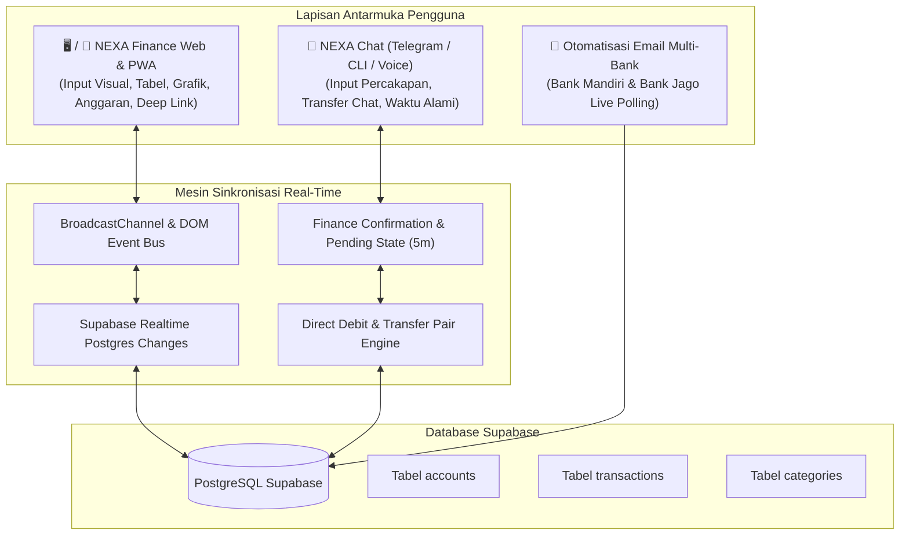

# 📘 Buku Panduan Pengguna & Pengalaman Pengguna (UX Guide)
## Ekosistem NEXA Finance — Web, PWA, & Percakapan AI

---

## 🌟 1. Filosofi & Arsitektur Ekosistem NEXA Finance

Ekosistem **NEXA Finance** dibangun dengan prinsip **Dual-Interface, Single-Truth**:
Satu database PostgreSQL di Supabase yang menjadi sumber kebenaran tunggal (*Single Source of Truth*), dapat diakses melalui dua pengalaman pengguna yang saling melengkapi:



1. **Pengalaman Visual (Web & PWA):** Terbaik untuk evaluasi mingguan/bulanan, melihat grafik tren saldo 30 hari, menavigasi detail rekening spesifik, merencanakan anggaran, dan audit catatan mutasi dengan pemuatan ulang data instan (*in-card refresh*).
2. **Pengalaman Percakapan (NEXA Chat / Telegram):** Terbaik untuk pencatatan kilat langsung di kasir, transfer saldo antar-rekening via teks santai, pendeteksian waktu komposit masa lalu (*"kemarin jam 9 malam"*), koreksi interaktif, serta kueri analitik eksekutif.
3. **Otomatisasi Latar Belakang (Multi-Bank Auto-Sync):** Transaksi dari email perbankan resmi (Bank Mandiri Livin & Bank Jago) disinkronkan otomatis tanpa perlu intervensi manual, mencakup QRIS, Transfer Bank, dan pembayaran *Direct Debit*.

---

## 🖥️ 2. Pengalaman Pengguna: NEXA Finance Web & PWA

### 2.1 Dasbor Eksekutif & Mode Privasi
* **Kartu Master "Total Saldo" (Paling Kiri):**
  * Menampilkan akumulasi kekayaan bersih dari seluruh rekening aktif secara *real-time*.
  * Bersifat *client-side aggregate*, menjaga kemurnian tabel `accounts`.
  * **Fitur Mode Privasi (Ikon Mata 👁️):** Klik ikon mata untuk menyamarkan seluruh nominal (Total Saldo dan saldo per rekening) menjadi `Rp ••••••••` saat berada di ruang publik atau kafe. Preferensi ini otomatis tersimpan secara persisten di perangkat (*LocalStorage*).
* **Deretan Kartu Rekening (Horizontal Scroll) & Navigasi Langsung:**
  * Kartu individual bank (misal: Bank Mandiri bergradien biru, Bank Jago bergradien hijau zamrud, Shopee Pay, Dana, Tunai).
  * Menampilkan saldo riil per rekening yang dihitung dinamis dari saldo awal + seluruh mutasi masuk/keluar.
  * **Navigasi Langsung ke Detail Akun (*Direct Deep-Link Navigation*):**  
    Mengeklik kartu akun mana pun di dasbor **langsung membuka tampilan Detail Akun** yang bersangkutan (`/accounts?id=<uuid>`), bukan sekadar membuka daftar akun.
  * **Pemuatan Halus (*Flicker-Free Loading*):**  
    Peralihan ke Detail Akun dilengkapi indikator pemuatan spinner yang halus, menjamin tidak ada kedipan pesan *"Akun tidak ditemukan"* saat data awal sedang dimuat.
  * **Navigasi Balik yang Mulus (*Back Button Sync*):**  
    Tombol kembali (*Back button*) pada Detail Akun secara otomatis mereset URL menjadi `/accounts` dan mengembalikan pengguna ke daftar seluruh rekening tanpa *full page reload*. Tombol navigasi browser (*Back/Forward*) tersinkronisasi 100%.
  * Tombol **`+ Tambah Akun`** di ujung scroll untuk menambah rekening bank atau e-wallet baru.
* **Spedometer Finansial:**
  * Tiga spedometer indikator cepat: **Saldo Saat Ini**, **Arus Kas Bersih**, dan **Total Pengeluaran**.
* **Widget Fleksibel (Drag & Drop):**
  * Kartu widget seperti *Tren Saldo*, *Struktur Pengeluaran (Donut Chart)*, dan *Perbandingan Periode* dapat ditata ulang posisinya dengan tombol **"Letak Terbuka / Letak Dikunci"**.

---

### 2.2 Alur Pencatatan Transaksi (Modal Input)

Akses modal melalui tombol hijau **`+ Catatan Baru`** di navigasi atas atau tombol `+` pada layar mobile.

#### A. Transaksi Pengeluaran (*Expense*)
1. Pilih tab **Pengeluaran** (warna merah).
2. Masukkan **Jumlah** (misal: `35000`).
3. Pilih **Account** asal (misal: `Bank Mandiri`, `Bank Jago`, `Shopee Pay`, `Dana`).
4. Pilih **Kategori** (tersedia 52 kategori terstruktur: *Makanan & Minuman*, *Transportasi*, *Belanja*, dll.).
5. Isi **Deskripsi** & pilih salah satu dari **5 Metode Pembayaran Resmi**:
   * **QRIS** (Lencana violet)
   * **Transfer bank** (Lencana biru)
   * **Kartu Kredit** (Lencana oranye)
   * **Tunai** (Lencana hijau)
   * **Direct Debit** (Lencana *teal* — untuk debit otomatis kartu/e-wallet seperti Shopee Pay Direct Debit / GoPay Jago).
6. Klik **Tambah catatan** (atau **Tambah dan buat lagi** jika ingin mencatat mutasi beruntun).

#### B. Transaksi Pemasukan (*Income*)
1. Pilih tab **Pemasukan** (warna hijau/biru).
2. Masukkan nominal, akun penerima, kategori pemasukan (misal: *Gaji, faktur*, *Hadiah*, *Investasi*, *Pengembalian dana*), serta tanggal & waktu transaksi.

#### C. Transfer Antar-Rekening (*Inter-Account Transfer Pair*)
Saat Tuan memindahkan saldo antar rekening sendiri (misal: dari Bank Mandiri ke Bank Jago, atau Dana ke Jago):
1. Pilih tab **Transfer** (warna biru khas).
2. Pilih **Dari akun** (misal: `Dana`) dan **Ke akun** (misal: `Bank Jago`).
3. Masukkan nominal transfer (misal: `50000`).
4. Klik **Tambah catatan**.
5. **Mekanisme Otomatis Dua Arah (*Balanced Dual-Leg Ledger*):**
   * Sistem secara atomik membuat sepasang transaksi terhubung (*transfer pair*) dengan satu `split_group_id` yang sama.
   * Baris 1: `split_label = transfer_out` pada Akun Asal (mengurangi saldo Dana).
   * Baris 2: `split_label = transfer_in` pada Akun Tujuan (menambah saldo Jago).
   * **Total saldo global (*Net Worth*) tetap konsisten Rp0 perubahan bersih**, saldo antar rekening berpindah secara sempurna!

---

### 2.3 Manajemen Catatan (*Records View*) & Fitur Canggih

* **Tombol Standalone "Refresh" (Gaya Supabase Table Editor):**
  * Terletak di pojok kanan atas div catatan (sejajar dengan teks *"Ditemukan X catatan"*).
  * **Hanya Me-refresh Div Catatan:** Tidak melakukan *full page reload* (`F5`). Tombol ini memicu fungsi `refetch()` internal React untuk menarik mutasi paling mutakhir dari database Supabase secara *asynchronous*.
  * **Animasi & Feedback:** Ikon panah melingkar berputar (*spin animation*) selama pemuatan data dan menampilkan toast konfirmasi: `"Catatan berhasil direfresh"`.
* **Filter Multifaset Pintar:**
  * Filter berdasarkan rentang tanggal kalender, akun spesifik, kategori pengeluaran/pemasukan, jenis catatan (Semua, Pengeluaran, Pemasukan, Transfer), hingga metode pembayaran (termasuk *Direct Debit*).
* **Alat Resolusi Duplikasi (*Deduplication Tool*):**
  * Pilih minimal 2 catatan dengan mencentang kotak seleksi, lalu klik tombol biru **`Atasi Duplikasi`**.
  * Sistem akan mempertahankan 1 catatan valid pertama dan menghapus baris duplikat lainnya secara bersih.
* **Tampilan Rincian Transaksi Terpisah (*Split Transactions*):**
  * Transaksi belanja multi-item yang dipecah dalam satu bon/struk dapat diekspansi untuk melihat rincian per pos belanja.
* **Pencarian Cepat:**
  * Bilah pencarian responsif untuk menemukan transaksi berdasarkan nama toko, catatan, atau nominal.

---

## 💬 3. Pengalaman Pengguna: NEXA Chat (Telegram / CLI / Voice)

Dirancang untuk kecepatan dan mobilitas tanpa batas. Tuan dapat berbicara atau mengetik santai dalam bahasa Indonesia alami.

### 3.1 Pencatatan Percakapan Cepat (Quick Natural Language Recording)

| Skenario | Contoh Perintah ke NEXA | Penjelasan UX & Aksi Sistem |
|---|---|---|
| **Pengeluaran Cepat** | *"Nexa catat barusan jajan kopi 35rb pake QRIS Jago"* | Otomatis mengidentifikasi nominal `35.000`, kategori `Jajan / Ngopi / Kafe`, metode `QRIS`, dan akun `Bank Jago`. |
| **Direct Debit Otomatis** | *"Beli es teh dua 9800 shopeepay direct debit"* | Mengenali metode `Direct Debit`, akun `Shopee Pay`, nominal `9.800`, dan kebal terhadap ambiguitas kata kuantitas (*"dua"* tidak memicu split). |
| **Waktu Komposit Alami** | *"Kemarin jam 9 malam beli martabak 30rb tunai"* | Engine pengurai waktu mengekstrak tanggal kemarin dan jam `21:00:00` WIB secara presisi, bukan waktu saat chat dikirim. |
| **Pemasukan** | *"Dapat transferan honor 1.5jt ke Mandiri"* | Mencatat tipe `INCOME`, nominal `1.500.000`, kategori `Pendapatan bisnis / honor`, rekening `Bank Mandiri`. |
| **Transfer Antar-Akun Chat** | *"Pindah saldo 50rb dari Dana ke Jago"* atau *"Tf 100rb dari Mandiri ke Shopee Pay"* | Cognitive Router mengenali intent `TRANSFER`, mengekstrak `from_account` dan `to_account`, lalu membuat sepasang transaksi terhubung (*transfer pair*) secara seimbang. |
| **Multi-Transaksi Sekaligus** | *"Tadi makan siang 25rb sama beli bensin 30rb pake Mandiri"* | Menangkap 2 transaksi sekaligus dan memprosesnya berurutan. |

---

### 3.2 Sistem Konfirmasi & Koreksi Interaktif (*Interactive Pending State*)

Ketika Tuan mencatat via chat atau saat sistem mendeteksi mutasi email yang memerlukan konfirmasi, NEXA mengirimkan kartu pratinjau:
> 📝 **Draft Transaksi Dicatat:**  
> • Nominal: Rp35.000  
> • Kategori: Jajan / Ngopi / Kafe  
> • Rekening: Bank Jago  
> • Metode: QRIS  
> • Waktu: 2 November 2026, 21:22 WIB  
> *(Ketik koreksi jika ada salah, atau biarkan 5 menit untuk tersimpan otomatis)*

**Kemampuan Koreksi Percakapan Tingkat Lanjut:**
* **Koreksi Waktu & Tanggal:**  
  *"Bukan tadi, tapi kemarin jam 8 malam"* atau *"Waktunya jam 20:30"* -> NEXA langsung memperbarui tanggal dan jam transaksi.
* **Koreksi Rekening:**  
  *"Bukan dari jago tapi mandiri"* -> Memindahkan rekening asal transaksi.
* **Koreksi Nominal:**  
  *"Eh salah nominalnya 45rb"* -> Memperbarui nominal menjadi Rp45.000.
* **Koreksi Kategori:**  
  *"Kategorinya ganti ke Traktir Teman"* -> Kategori langsung diubah.
* **Pembatalan:**  
  *"Batal"* atau *"Jangan dicatat"* -> Draft dibuang seketika tanpa tersimpan ke database.

---

### 3.3 Kueri Laporan & Analitik Finansial (Financial Intelligence)

Tuan dapat meminta wawasan analitik kapan saja di kolom chat:

```text
User: "Nexa, bagaimana tren belanja bulan ini?"

NEXA:
📈 Tren Pengeluaran Harian — Bulan Ini
Pola: 📉 Menurun di akhir periode
Rata-rata harian: Rp106.078 / hari
Hari termahal: 2026-10-01 (Rp2.000.000)
Hari terhemat: 2026-10-12 (Rp6.000)
Hari ada transaksi: 9 hari

Grafik Pengeluaran (14 Hari Terakhir):
10-18 ░░░░░░░░ Rp0
10-19 ░░░░░░░░ Rp20.000
10-30 ████████ Rp1.098.424
```

#### Menu Kueri Pintar Lainnya:
1. **Cek Saldo Real-Time:**  
   *"Cek saldo semua akun"* / *"Berapa total uang saya?"*  
   👉 Menampilkan rincian saldo Bank Mandiri, Bank Jago, Shopee Pay, Dana, dompet tunai, serta **Total Kekayaan Bersih**.
2. **Top Pengeluaran Terbesar:**  
   *"Pengeluaran terbesar saya bulan ini apa saja?"*  
   👉 Menyajikan 5 pos paling menguras kantong beserta merchant dan tanggalnya.
3. **Komparasi Antar-Periode:**  
   *"Bandingkan pengeluaran bulan ini dengan bulan kemarin"*  
   👉 Menghitung persentase delta (Δ%) belanja dan laju pengeluaran (*spending velocity*).
4. **Analisis Rasio Tabungan (*Saving Rate*):**  
   *"Berapa saving rate saya?"*  
   👉 Menyajikan persentase tabungan dan evaluasi kesehatan finansial (*Sangat Sehat / Waspada / Defisit*).
5. **Ringkasan Eksekutif 360°:**  
   *"Beri ringkasan finansial cerdas"*  
   👉 Laporan menyeluruh gabungan saldo, arus kas, top kategori, disertai **insight nasihat AI** yang hangat dan solutif.

---

## ⚡ 4. Matriks Skenario Penggunaan Praktis (Harian)

| Waktu / Situasi | Rekomendasi Media | Alur Tindakan |
|---|---|---|
| **Saat di Kasir / Merchant Fisik** | 💬 **Telegram Chat** | Kirim pesan cepat/suara: *"QRIS Kopi Kenangan 28rb Jago"*. Tersimpan dalam 3 detik tanpa buka aplikasi. |
| **Belanja Online / E-Wallet Direct Debit** | 💬 **Telegram Chat** | Catat santai: *"Beli barang 45rb Shopeepay direct debit tadi sore jam 4"*. Sistem mencatat jam dan metode tepat. |
| **Pemindahan Saldo Antar Rekening** | 💬 **Chat / 🖥️ Web Transfer** | Ketik: *"Pindah saldo 50rb dari Dana ke Jago"*. Kedua rekening langsung tersinkronisasi tanpa menduplikasi pemasukan. |
| **Notifikasi Transfer Masuk Email** | 📧 **Otomatis (Zero-Click)** | NEXA Email Poller otomatis mendeteksi mutasi Mandiri / Jago di background dan mencatatkannya ke database. |
| **Review & Audit Mingguan** | 🖥️ **NEXA Finance Web** | Buka Dasbor, klik kartu rekening untuk cek grafik tren saldo 30 hari, atau buka tab Catatan dan klik tombol **Refresh** untuk cek mutasi terkini. |
| **Koreksi Data Lama** | 🖥️ **Web Records View** | Buka tab *Catatan*, gunakan filter pencarian, klik tombol pensil untuk mengedit atau centang beberapa baris untuk atasi duplikasi. |

---

## 🔒 5. Jaminan Keamanan Data & Integritas

1. **Pemisahan Logika Dompet & Anti-Duplikasi Bersih:**
   * Mutasi transfer antar-akun selalu berpasangan imbang (*transfer_out* dan *transfer_in*). Total kekayaan master selalu murni kalkulasi dinamis tanpa inflasi semu.
2. **Perlindungan Anti False-Positive:**
   * Parser split transaksi terlindungi dari salah tafsir kata jumlah (seperti *"dua"*), menjaga keutuhan deskripsi catatan.
3. **Kerahasiaan Layar:**
   * Fitur toggle mata melindungi privasi saldo saat menggunakan laptop di tempat umum.
4. **Penyimpanan Cloud Terenkripsi:**
   * Seluruh data tersimpan aman di infrastruktur PostgreSQL Supabase dengan perlindungan SSL/TLS penuh dan isolasi multi-tenant terjamin.
